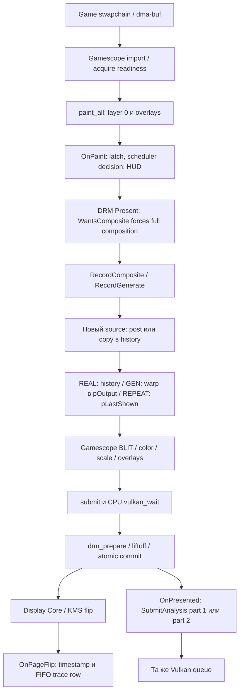

# 01. Фактический конвейер Kedavra 1.4.1

## Область аудита

Проанализированы integration `kfg.cpp/kfg.hpp`, `hooks.patch`, план проходов, standalone Vulkan host, scheduler и Auto, shaders, deck scripts, материалы `docs/kedavra` и аппаратные evidence. Также просмотрен внешний GFG Extreme на отдельном SHA, поскольку его power controller не находится в этом репозитории. Полные версии — [10](10-SOURCES.md).

Критически важно различать два host: `kfg_vk.c` — самостоятельный тестовый Vulkan host; рабочая интеграция вызывает `CVulkanCmdBuffer` и `g_device` Gamescope. `vkWaitForFences(UINT64_MAX)` в тестовом host **не доказывает** такой wait в каждом рабочем проходе: [kedavra/engine/kfg_vk.c:80](https://github.com/wavessevaw/GSF_Kedavra/blob/5f22938b55f9853f764e927c847d9c1a8d9a8c04/kedavra/engine/kfg_vk.c#L80).

## Путь кадра

Не каждый граф означает отдельное копирование. Импорт dma-buf и регистрация framebuffer разделяют allocation/metadata. Полноэкранные shader copy и composite действительно читают и записывают пиксели.

## Владение и операции по этапам

| Этап | Владелец и данные | CPU | GPU / копии | Готовность |
|---|---|---|---|---|
| Game → Gamescope | Game владеет swapchain allocation; Gamescope держит buffer/commit и imported Vulkan texture | импорт, acquire/release bookkeeping | импорт сам по себе не требует full-frame copy | explicit acquire timeline либо implicit dma-buf/memory fence |
| Латч | Gamescope выбирает готовый commit; layer 0 может уже быть результатом preemptive upscale/override | paint, IDs, FPS cap, vblank grid | до Kedavra возможны отдельные проходы upstream | ImageWaiter отмечает commit готовым |
| History | Kedavra `Frame_t[6]` owns textures; CMD buffer удерживает references | выбрать slot, собрать plan и constants | одна full-frame shader copy на новый source либо post chain + copy | same queue + history barrier |
| Анализ | В slot пары: luma, flow, stats, pairSelect; scratch pSelect общий | подготовка plan; две отправки | 12 dispatch на полную пару в стандартной конфигурации | тот же VkQueue; scheduler заранее обещано +2 vblank |
| GEN | Kedavra `pOutput[2]` | выбрать phase и пары | один warp dispatch при default pair selection | очередь и barriers |
| REAL / REPEAT | history texture либо `pLastShown` | подстановка texture | дополнительный warp не нужен | прежний порядок queue |
| Финальная композиция | Gamescope output ring, flippable image | выбор pipelines/слоёв; ожидание sequence | BLIT/color/scale + overlays; при FSR/blur возможны дополнительные passes | CPU `vulkan_wait`, потом KMS |
| DRM/KMS | Gamescope DRM session; backend FB refs queued/visible; allocation удерживается через handles/refs | liftoff, atomic ioctl, event processing | DCN читает framebuffer; full-frame shader copy не обязателен | уже готовый buffer; текущий IN_FENCE сигнальный |
| Panel | KMS/Display Core | OnPageFlip stamp | scanout | flip event подтверждает presentation event, не pixel novelty |

Game buffer lifetime заканчивается только после отпускания соответствующего release/commit. История — независимая копия, позволяющая не удерживать множество game swapchain images.

Импорт и ожидание входа: [src/steamcompmgr.cpp:8687](https://github.com/ValveSoftware/gamescope/blob/aa289ea5977d8b21b92b0f246f0e8f0c225d180f/src/steamcompmgr.cpp#L8687) и [src/commit.cpp:54](https://github.com/ValveSoftware/gamescope/blob/aa289ea5977d8b21b92b0f246f0e8f0c225d180f/src/commit.cpp#L54). Предварительное масштабирование имеет собственные timeline dependencies и release points: [src/steamcompmgr.cpp:8645](https://github.com/ValveSoftware/gamescope/blob/aa289ea5977d8b21b92b0f246f0e8f0c225d180f/src/steamcompmgr.cpp#L8645). Нельзя приравнивать layer 0 к «сырому game render target» во всех конфигурациях.

## Точные интеграционные точки

### WantsComposite / WantsEveryVBlank

[kedavra/gamescope/src/kfg/kfg.cpp:1061](https://github.com/wavessevaw/GSF_Kedavra/blob/5f22938b55f9853f764e927c847d9c1a8d9a8c04/kedavra/gamescope/src/kfg/kfg.cpp#L1061): генерация или scheduler в процессе выключения требуют paint каждый vblank; active post для игры также требует composite. [kedavra/gamescope/hooks.patch:20](https://github.com/wavessevaw/GSF_Kedavra/blob/5f22938b55f9853f764e927c847d9c1a8d9a8c04/kedavra/gamescope/hooks.patch#L20) добавляет этот флаг к `bNeedsFullComposite` DRM backend. Это **программный запрет текущего direct scanout**, а не доказательство невозможности DCN.

Просто удалить этот флаг нельзя: `RecordComposite` вызывается только из `vulkan_composite`. Без выделенной стадии preparation исчезнут copy/warp и подстановка layer 0.

### OnPaint

[kedavra/gamescope/src/kfg/kfg.cpp:1071](https://github.com/wavessevaw/GSF_Kedavra/blob/5f22938b55f9853f764e927c847d9c1a8d9a8c04/kedavra/gamescope/src/kfg/kfg.cpp#L1071):

- обновляет post config, удерживает фиксированную сетку при выбранной генерации (allowVRR=false);
- запускает trace writer, пишет status с периодом, опрашивает и добавляет Kedavra HUD;
- исключает Steam AppID 769 из генерации и сбрасывает историю при входе UI;
- считает source по смене base commit ID, а не по KMS FPS;
- обновляет Auto, multiplier и vblank index;
- сбрасывает историю при смене refresh/focus/transfer/размера;
- вызывает `on_latch`, затем **сразу** `kfg_sched_on_me(id,nVBlank+2,true,false)`;
- получает решение `kfg_sched_decide`, сбрасывает `bRepeatFrame` для выполнения композиции.

[kedavra/gamescope/src/kfg/kfg.cpp:1230](https://github.com/wavessevaw/GSF_Kedavra/blob/5f22938b55f9853f764e927c847d9c1a8d9a8c04/kedavra/gamescope/src/kfg/kfg.cpp#L1230) — конкретный прогноз готовности. CPU не читает cut из stats: `cut=false` в bridge; shader warp сам проверяет stats.x. Поэтому scheduler reasons и shader cut — разные уровни.

### RecordComposite / RecordGenerate

[kedavra/gamescope/src/kfg/kfg.cpp:1355](https://github.com/wavessevaw/GSF_Kedavra/blob/5f22938b55f9853f764e927c847d9c1a8d9a8c04/kedavra/gamescope/src/kfg/kfg.cpp#L1355) загружает HUD, проверяет source, выставляет query timestamps и выполняет generation/post. `bApplied` выставляется до части проверок: trace bypass не является доказательством корректно записанного warp.

[kedavra/gamescope/src/kfg/kfg.cpp:1253](https://github.com/wavessevaw/GSF_Kedavra/blob/5f22938b55f9853f764e927c847d9c1a8d9a8c04/kedavra/gamescope/src/kfg/kfg.cpp#L1253):

1. shader write→read/write history barrier;
2. для нового source закончить оставшийся queued analysis, если новый source пришёл раньше ожидаемого;
3. `RecordPost(...,cur.pColor)` либо `RecordCopy`;
4. сохранить pair IDs и построить новый analysis plan;
5. REAL берёт history; GEN проверяет соответствие pair IDs и пишет warp; REPEAT берёт last shown;
6. заменить только texture layer 0. Геометрия и colorspace слоя сохраняются.

Фильтры сейчас могут исполняться **до анализа, на входе в кольцо**, один раз на source, а не после каждого generated output. Это видно в [kedavra/gamescope/src/kfg/kfg.cpp:1281](https://github.com/wavessevaw/GSF_Kedavra/blob/5f22938b55f9853f764e927c847d9c1a8d9a8c04/kedavra/gamescope/src/kfg/kfg.cpp#L1281) и [kedavra/gamescope/src/kfg/kfg.cpp:822](https://github.com/wavessevaw/GSF_Kedavra/blob/5f22938b55f9853f764e927c847d9c1a8d9a8c04/kedavra/gamescope/src/kfg/kfg.cpp#L822). Комментарий в `kfg.hpp` и часть заголовков описывают старую последовательность. Анализ в режиме фильтров читает filtered ring; менять это в исследовательском patch нельзя без отдельной проверки качества.

### SubmitAnalysis / асинхронные результаты

[kedavra/gamescope/src/kfg/kfg.cpp:1405](https://github.com/wavessevaw/GSF_Kedavra/blob/5f22938b55f9853f764e927c847d9c1a8d9a8c04/kedavra/gamescope/src/kfg/kfg.cpp#L1405) создаёт CMD и отправляет его через тот же `g_device.submit`. Split=7:

- part 1: reduce L1,L2,L3,L4; ME L4; global; ME L3;
- part 2: ME L2; stats; select; repair; repair.
- Первый source после reset имеет только четыре reduce и не является полноценной парой.

План подтверждает 12 passes, default generation — один warp: [kedavra/engine/kfg_plan.h:309](https://github.com/wavessevaw/GSF_Kedavra/blob/5f22938b55f9853f764e927c847d9c1a8d9a8c04/kedavra/engine/kfg_plan.h#L309) и [kedavra/engine/kfg_plan.h:396](https://github.com/wavessevaw/GSF_Kedavra/blob/5f22938b55f9853f764e927c847d9c1a8d9a8c04/kedavra/engine/kfg_plan.h#L396). Selection уже переиспользуется для фаз; предложить эту оптимизацию заново было бы ошибкой.

`AnalysisTimingDrain` читает availability без WAIT_BIT и суммирует время частей. Записи содержат slot/part2, но не pair ID/epoch. Это телеметрия, не completion bridge. Сама синхронизация исполнения обеспечивается same queue и memory barriers. Без отдельного завершения анализа нет достоверного наблюдения `me_late` относительно фактического GPU completion: [kedavra/gamescope/src/kfg/kfg.cpp:567](https://github.com/wavessevaw/GSF_Kedavra/blob/5f22938b55f9853f764e927c847d9c1a8d9a8c04/kedavra/gamescope/src/kfg/kfg.cpp#L567).

### OnPresented / OnPageFlip

[kedavra/gamescope/src/kfg/kfg.cpp:1443](https://github.com/wavessevaw/GSF_Kedavra/blob/5f22938b55f9853f764e927c847d9c1a8d9a8c04/kedavra/gamescope/src/kfg/kfg.cpp#L1443) отправляет анализ **даже перед проверкой bPresented**, затем при успешном present помещает decision в trace FIFO. [kedavra/gamescope/src/kfg/kfg.cpp:1466](https://github.com/wavessevaw/GSF_Kedavra/blob/5f22938b55f9853f764e927c847d9c1a8d9a8c04/kedavra/gamescope/src/kfg/kfg.cpp#L1466) игнорирует sequence и связывает flip с первым FIFO decision. Нет привязки к atomic present ID, CRTC epoch или content hash. Есть окно гонки: kernel event может прийти до добавления trace row. Это ограничение корреляции, не доказанный каждый раз дефект отображения.

[src/Backends/DRMBackend.cpp:772](https://github.com/ValveSoftware/gamescope/blob/aa289ea5977d8b21b92b0f246f0e8f0c225d180f/src/Backends/DRMBackend.cpp#L772) меняет queued→visible framebuffer refs и уведомляет ожидающих. При будущих нескольких in-flight commit нужно связывать release и trace с `DRMPresentCtx`, а не с глобальным FIFO.

## Queues, ожидания и приоритеты

[src/rendervulkan.cpp:368](https://github.com/ValveSoftware/gamescope/blob/aa289ea5977d8b21b92b0f246f0e8f0c225d180f/src/rendervulkan.cpp#L368) выбирает compute family, если доступна; general используется для отдельных нужд/forced fallback. Создаётся **одна рабочая queue** этой family. Priority realtime запрашивается при CAP_SYS_NICE с fallback: [src/rendervulkan.cpp:542](https://github.com/ValveSoftware/gamescope/blob/aa289ea5977d8b21b92b0f246f0e8f0c225d180f/src/rendervulkan.cpp#L542) и [src/rendervulkan.cpp:687](https://github.com/ValveSoftware/gamescope/blob/aa289ea5977d8b21b92b0f246f0e8f0c225d180f/src/rendervulkan.cpp#L687).

[src/rendervulkan.cpp:1323](https://github.com/ValveSoftware/gamescope/blob/aa289ea5977d8b21b92b0f246f0e8f0c225d180f/src/rendervulkan.cpp#L1323) уже сигналит timeline semaphore каждой submission. [src/rendervulkan.cpp:1563](https://github.com/ValveSoftware/gamescope/blob/aa289ea5977d8b21b92b0f246f0e8f0c225d180f/src/rendervulkan.cpp#L1563) делает CPU wait на timeline; DRM Present вызывает его после композиции: [src/Backends/DRMBackend.cpp:4044](https://github.com/ValveSoftware/gamescope/blob/aa289ea5977d8b21b92b0f246f0e8f0c225d180f/src/Backends/DRMBackend.cpp#L4044). Descriptor reuse также может блокировать CPU: [src/rendervulkan.cpp:1387](https://github.com/ValveSoftware/gamescope/blob/aa289ea5977d8b21b92b0f246f0e8f0c225d180f/src/rendervulkan.cpp#L1387). Это реальный источник waits, в отличие от standalone fence в `kfg_vk.c`.

Ring allocation не flippable: [kedavra/gamescope/src/kfg/kfg.cpp:385](https://github.com/wavessevaw/GSF_Kedavra/blob/5f22938b55f9853f764e927c847d9c1a8d9a8c04/kedavra/gamescope/src/kfg/kfg.cpp#L385). History barrier — [kedavra/gamescope/src/kfg/kfg.cpp:697](https://github.com/wavessevaw/GSF_Kedavra/blob/5f22938b55f9853f764e927c847d9c1a8d9a8c04/kedavra/gamescope/src/kfg/kfg.cpp#L697); image layout и foreign export выполняет Gamescope tracker: [src/rendervulkan.cpp:1966](https://github.com/ValveSoftware/gamescope/blob/aa289ea5977d8b21b92b0f246f0e8f0c225d180f/src/rendervulkan.cpp#L1966).

## Опоздания и аппаратные ограничения

Scheduler умеет repeat, slowdown/catch-up, resync, degraded/recover: [kedavra/sched/kfg_sched.h:145](https://github.com/wavessevaw/GSF_Kedavra/blob/5f22938b55f9853f764e927c847d9c1a8d9a8c04/kedavra/sched/kfg_sched.h#L145) и [kedavra/sched/kfg_sched.h:510](https://github.com/wavessevaw/GSF_Kedavra/blob/5f22938b55f9853f764e927c847d9c1a8d9a8c04/kedavra/sched/kfg_sched.h#L510). Но GPU не прерывается по `kfg_budget_us`: это постфактум счётчик elapsed timestamps. Если analysis занимает queue, следующий composite дождётся его; готовый слишком поздно framebuffer уйдёт на более поздний refresh. Safe fallback не отменяет уже отправленную GPU работу.

`gpu_us` охватывает весь участок Kedavra, включая copy/post на source и иногда остаток analysis; не только warp. `gpu_analysis_us` суммирует части без промежутка между ними. Timestamps TOP→BOTTOM — elapsed GPU-region, могут включать stall/preemption; это не число «чистых ALU ms». Они не дают CPU-submit→GPU-start: [kedavra/gamescope/src/kfg/kfg.cpp:589](https://github.com/wavessevaw/GSF_Kedavra/blob/5f22938b55f9853f764e927c847d9c1a8d9a8c04/kedavra/gamescope/src/kfg/kfg.cpp#L589).

Обязательны fixed refresh для нынешнего scheduler; поддерживаемые source formats; compatible Vulkan usage; KMS format/modifier/rotation/цвет/ресурсы planes; lifetime до retirement. HDR сейчас поддержан в float history, несмотря на старые SDR-only документы. YCbCr и неподдерживаемые форматы обходят генерацию. Полная модель движения данных — [04](04-MEMORY-ZERO-COPY.md).

Дополнительная CPU работа: `WriteStatus` раз в секунду делает fopen/fprintf/fclose/rename непосредственно из `OnPaint`; trace CSV вынесена в отдельный writer thread. Перенос status publication в worker — отдельный возможный CPU cleanup, не доказанный источник аппаратных misses. `compose_late` в `WriteTraceRow` печатается literal 0, а не измеряется: [kfg.cpp:870](https://github.com/wavessevaw/GSF_Kedavra/blob/5f22938b55f9853f764e927c847d9c1a8d9a8c04/kedavra/gamescope/src/kfg/kfg.cpp#L870). Это ещё одна причина не считать архивный compose_late=0 доказательством своевременности.
