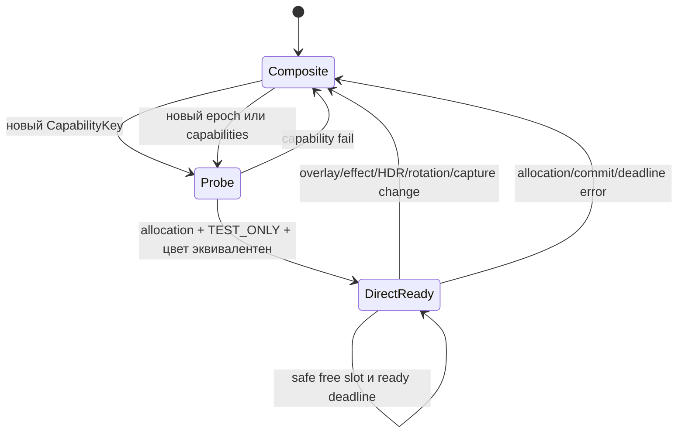

# 02. DirectScan — приоритет A

## Что именно можно удалить

Текущий минимальный GEN путь: history A/B → warp → pOutput → Gamescope BLIT → flippable composite framebuffer → DCN. При выполнении условий DirectScan: history A/B → warp → flippable output → DCN. Удаляется **один полноэкранный shader pass** с чтением результата warp и записью composite. Warp, motion analysis, scanout read и входная history copy сохраняются.

Это доказуемое структурное сокращение, но не измеренные GPU ms или watts. Если потребуется полноэкранный copy/convert перед scanout, сокращение pass count станет нулевым; такой маршрут сравнивается отдельно и не объявляется zero-copy.

## Аппаратный и API фундамент

VANGOGH сопоставлен с DCN 3.0.1: [drivers/gpu/drm/amd/display/dc/core/dc_resource.c:180](https://github.com/torvalds/linux/blob/038d61fd642278bab63ee8ef722c50d10ab01e8f/drivers/gpu/drm/amd/display/dc/core/dc_resource.c#L180). Resource table содержит universal planes, alpha, FP16 и scaler capabilities: [drivers/gpu/drm/amd/display/dc/resource/dcn301/dcn301_resource.c:640](https://github.com/torvalds/linux/blob/038d61fd642278bab63ee8ef722c50d10ab01e8f/drivers/gpu/drm/amd/display/dc/resource/dcn301/dcn301_resource.c#L640). Четыре внутренних video-plane ресурса **не гарантируют четыре свободных KMS overlays** для данного CRTC. Нужны фактические plane inventory и atomic validation.

Gamescope уже умеет выделять flippable storage images:

- `CVulkanTexture::BInit`: bFlippable → bExportable, SAMPLED/STORAGE usage: [src/rendervulkan.cpp:2102](https://github.com/ValveSoftware/gamescope/blob/aa289ea5977d8b21b92b0f246f0e8f0c225d180f/src/rendervulkan.cpp#L2102);
- пересечение backend modifiers с Vulkan external image properties: [src/rendervulkan.cpp:2245](https://github.com/ValveSoftware/gamescope/blob/aa289ea5977d8b21b92b0f246f0e8f0c225d180f/src/rendervulkan.cpp#L2245);
- DMA_BUF external memory и modifier tiling: [src/rendervulkan.cpp:2306](https://github.com/ValveSoftware/gamescope/blob/aa289ea5977d8b21b92b0f246f0e8f0c225d180f/src/rendervulkan.cpp#L2306);
- экспорт FD, plane offsets/pitches и modifier: [src/rendervulkan.cpp:2520](https://github.com/ValveSoftware/gamescope/blob/aa289ea5977d8b21b92b0f246f0e8f0c225d180f/src/rendervulkan.cpp#L2520);
- backend import: [src/rendervulkan.cpp:2605](https://github.com/ValveSoftware/gamescope/blob/aa289ea5977d8b21b92b0f246f0e8f0c225d180f/src/rendervulkan.cpp#L2605);
- PRIME handles и `drmModeAddFB2WithModifiers`: [src/Backends/DRMBackend.cpp:1881](https://github.com/ValveSoftware/gamescope/blob/aa289ea5977d8b21b92b0f246f0e8f0c225d180f/src/Backends/DRMBackend.cpp#L1881).

**SUPPORTED:** инфраструктура достаточна для allocation experiment без собственного GBM manager. GBM — альтернативный allocator/import path, не обязательная дополнительная стадия. DMA-buf FD обозначает allocation, а не копию пикселей и не готовность.

### Требования к image

Нужен один VkImage, одновременно пригодный для storage writes, дальнейшего sampling при fallback и DRM FB. Проверить:

1. физическое устройство Vulkan совпадает с DRM output device;
2. формат RGBA/BGRA и alpha semantics соответствуют DRM fourcc, shader storage view — без запрещённого swizzle;
3. modifier поддержан plane `IN_FORMATS`, выбран для **полного набора usage** через `vkGetPhysicalDeviceImageFormatProperties2` + `VkPhysicalDeviceImageDrmFormatModifierInfoEXT`;
4. external memory exportable DMA_BUF; dedicated-only requirements и память/offset alignment соблюдены;
5. plane count, offsets, pitches, размеры и modifier взяты из созданного image; DCC metadata plane не является второй цветовой overlay;
6. atomic TEST_ONLY проходит с реальной геометрией, rotation, HDR/CTM/LUT и всеми overlays.

`OPTIMAL_TILING` само по себе не даёт KMS-compatible layout. Нельзя объявить уже созданный обычный image «linear» или придумать modifier задним числом. Для новых allocations выбирать modifier заранее через ListCreateInfo либо импортировать совместимый GBM dma-buf через ExplicitCreateInfo. Предпочтителен уже существующий allocator Gamescope.

Kernel отдельно фильтрует формат/modifier и проверяет DCC, scaling/rotation/bandwidth: [drivers/gpu/drm/amd/display/amdgpu_dm/amdgpu_dm_plane.c:1520](https://github.com/torvalds/linux/blob/038d61fd642278bab63ee8ef722c50d10ab01e8f/drivers/gpu/drm/amd/display/amdgpu_dm/amdgpu_dm_plane.c#L1520), [drivers/gpu/drm/amd/display/amdgpu_dm/amdgpu_dm_plane.c:262](https://github.com/torvalds/linux/blob/038d61fd642278bab63ee8ef722c50d10ab01e8f/drivers/gpu/drm/amd/display/amdgpu_dm/amdgpu_dm_plane.c#L262), [drivers/gpu/drm/amd/display/amdgpu_dm/amdgpu_dm.c:11750](https://github.com/torvalds/linux/blob/038d61fd642278bab63ee8ef722c50d10ab01e8f/drivers/gpu/drm/amd/display/amdgpu_dm/amdgpu_dm.c#L11750). FP16 capability не означает любой FP16+DCC modifier: для исследованного pre-GFX12 пути DCC format filter допускает cpp=4, FP16 colour cpp=8 требует другого modifier. RADV тоже проверяет storage/DCC ограничения: [src/amd/vulkan/radv_image.c:244](https://github.com/chaotic-cx/mesa-mirror/blob/d246f60ddf53089faa1d554865f7a38a737ed388/src/amd/vulkan/radv_image.c#L244).

## A1. Warp непосредственно в scanout allocation

**SUPPORTED механизм / HYPOTHESIS выигрыш.**

| Элемент проекта | Решение |
|---|---|
| Текущая архитектура | 2 внутренних pOutput, sampled/storage, затем BLIT |
| Ограничение | Нет backend FB, lifetime не связан с KMS |
| Новая архитектура | Отдельный `ScanoutPool` с texture + backendFb + readiness + retirement |
| Почему экономнее | Убирает промежуточный full-frame read/write, при одинаковом warp |
| Файлы/функции | `kfg.cpp::CreateImage/EnsureImages/ResolveRef/RecordGenerate`, `kfg.hpp`; `rendervulkan.cpp::BInit`, `DRMBackend.cpp::Present/drm_prepare_liftoff/Commit/page_flip_handler` |
| Новые данные | `PreparedFrame`, `ScanoutSlot`, `CapabilityKey`, `PresentToken`; schema в [07](07-IMPLEMENTATION-ROADMAP.md) |
| API | DRM modifiers, external memory DMA_BUF, atomic TEST_ONLY, IN_FENCE_FD, backend FB import |
| Владение | Kedavra owns slot, Gamescope owns DRM commit; slot holds allocation пока writing/queued/visible |
| Sync | Same queue barriers; timeline completion; сначала CPU wait для изоляции A/B, затем отдельный fence experiment |
| Fallback | Sampling того же scanout image в обычной композиции, без повторного warp |
| Governor | Маршрут и cost model входят в epoch; сам DirectScan не меняет TDP |
| Риски | Плохой modifier, цвет, удержание current FB, reuse во время scanout, переполнение pool |
| Этапы | allocation validation → подготовка вне composite → SDR scanout → overlays/Mura → HDR → nonblocking fence |
| Проверка | E1/E2/E3 в [08](08-EXPERIMENTS.md), GPU dispatch trace + pixel/optical checks |
| Stop | Нет общего modifier; дополнительный full-frame copy съедает выигрыш; ухудшается image quality/FPS/pacing; нет измеримого эффекта |

Не переиспользовать `pOutput[2]` по XOR как scanout ring. Минимум кандидатов определяется max queued + current visible + writer; начать с трёх при одном pending commit, но размер не заменяет retirement. Если свободного slot нет — сохранить последний complete framebuffer или перейти к composition с безопасным output, не ждать бесконечно и не перезаписывать visible slot.

REAL кадры тоже надо учитывать: текущие history frames не flippable. В A1 первоначально использовать DirectScan только для GEN, REAL — compose. Измерить стоимость переключения и итог за полный source interval. Дополнительный вариант — flippable colour history slots для direct REAL, если их tiling не ухудшает analysis/warp и удержание scanout не мешает записи. Шесть history slots могут быть связаны с KMS references; размер не доказывает достаточность во всех задержках.

## A2. Изменить завершающую стадию Gamescope

**SUPPORTED механизм / HYPOTHESIS выигрыш.** Этот вариант определяет routing и может использовать A1 allocator. Это два инженерных варианта с общей инфраструктурой, а не два независимых ускорения, которые можно складывать.

Сохранить plan, шейдерный алгоритм и motion pipeline Kedavra. Разделить нынешний hook:

```cpp
// Предлагаемый интерфейс, в этой ветке не реализован.
PreparedFrame PrepareFrame(FrameInfo_t const&, PaintToken);
void RecordPrepared(CVulkanCmdBuffer&, PreparedFrame&);
void ApplyPreparedLayer(FrameInfo_t&, PreparedFrame const&);
void NotifyPresentation(PresentToken, PresentResult);
```

`OnPaint` остаётся источником policy/latch. `PrepareFrame/RecordPrepared` выполняются **до** `CDRMBackend::Present`-решения direct/composite. Подготовленный layer 0 с backendFb проверяется существующим `drm_prepare`; overlays проходят через прежний liftoff. На fallback `vulkan_composite` получает уже подготовленный layer и не вызывает Kedavra второй раз.

Самый компактный A2 — направить последний warp в свободный **существующий Gamescope output image**, если его usage/размер/цвет полностью подходят. Нужна аренда slot через output-ring owner, а не самостоятельное изменение `g_output.nOutImage`. В чистом single-plane случае его можно считать готовым output. При overlays/неподходящей цветовой обработке — обычная композиция в другой свободный image. Нельзя одновременно читать и писать тот же composite image. Если аренда требует лишней копии или ломает output-ring contract, использовать A1 pool.

| Элемент проекта | Решение A2 |
|---|---|
| Текущий маршрут | Kedavra спрятана внутри vulkan_composite |
| Ограничение | Backend обязан выбрать composition, чтобы вообще вызвать generation |
| Новая архитектура | prepare once → capability evaluation → scanout либо compose prepared |
| Удаляемая работа | Только финальный BLIT в eligible случае; не анализ и не KMS commit |
| Изменяемые функции | `paint_all` hook; `kfg::RecordComposite/WantsComposite`; `vulkan_composite/vulkan_get_last_output_image`; `CDRMBackend::Present` |
| Данные | PaintToken с флагами recorded/applied; PreparedFrame с original layer metadata и output lease |
| API | Имеющийся Vulkan allocator/backend import; новый internal output lease API |
| Владение | Gamescope output pool выдаёт lease до KMS retirement; immutable result описывает подготовленный кадр |
| Sync | Сначала сохранить существующий wait; затем per-layer fence без global always-signaled подмены |
| Fallback | Один recorded warp, prepared frame sampled обычным BLIT; при failed allocation — исходный production path |
| Governor | Метки route/cost и policy revision; без самостоятельного power control |
| Риск SteamOS | UI исчезает при неверном routing, двойной warp, alias output, неверное управление output ring |
| Этапы | Разделение API без изменения картинки → parity tests → direct eligibility → аренда output |
| Проверка | Считать pass count, сверять IDs, overlays и каждые переходы; полный A/B/A |
| Stop | Нельзя выделить независимо writable slot; нет eligible кадров в реальных настройках; net cost ≥ baseline |

## Синхронизация без скрытого ожидания

Сейчас DRM Present делает `vulkan_wait`, а liftoff получает `g_nAlwaysSignalledSyncFile`: [src/Backends/DRMBackend.cpp:4058](https://github.com/ValveSoftware/gamescope/blob/aa289ea5977d8b21b92b0f246f0e8f0c225d180f/src/Backends/DRMBackend.cpp#L4058) и [src/Backends/DRMBackend.cpp:2890](https://github.com/ValveSoftware/gamescope/blob/aa289ea5977d8b21b92b0f246f0e8f0c225d180f/src/Backends/DRMBackend.cpp#L2890). Просто убрать wait опасно.

Два этапа:

- **A1-Sync0:** сохранить wait только на sequence финального writer. Это проверяет экономию GPU-прохода независимо от новой KMS synchronization.
- **A1-Sync1:** signal binary exportable semaphore в той же submission, что и release image в FOREIGN; получить SYNC_FD и передать **реальный per-layer FD** в IN_FENCE_FD. Или дополнить имеющийся Timeline bridge экспортом: отдельный exportable CTimeline получает signal в final submission, после materialization выполнить drmSyncobjTransfer из нужного timeline point в binary syncobj point 0, затем drmSyncobjExportSyncFile. Существующий CTimeline сейчас умеет import dma-buf fences и CreateEventFd, но метода export sync_file нет; его надо добавить. Eventfd нельзя подавать как IN_FENCE_FD. Feature support и права проверить. Сохранить ownership FD/dup/close при TEST_ONLY, real commit, rollback, EBUSY/error. Не подавать opaque timeline FD напрямую в KMS.

[Зафиксированная Vulkan specification](https://github.com/KhronosGroup/Vulkan-Docs/blob/a8b088a3fae12c8575407ea90c7c09bd653db923/chapters/synchronization.adoc#L4012): SYNC_FD export с copy-transference требует binary semaphore; timeline остаётся внутренним счётчиком. См. [Vulkan VkSemaphoreGetFdInfoKHR](https://docs.vulkan.org/refpages/latest/refpages/source/VkSemaphoreGetFdInfoKHR.html). KMS out-fence относится к commit, который стал visible; для освобождения старого slot нужен commit **замены** этого FB, а не его собственный первый out-fence. Если FB остаётся при repeat, release не наступил.

`IN_FENCE_FD` обеспечивает зависимость готовности, но не резервирует ближайший vblank. Late fence → late flip. Не отправлять на KMS заведомо незавершимый по прогнозу buffer; выбирать уже ready fallback до commit cutoff. Отправленная submission/commit не отменяется обычным Vulkan API.

## Eligibility, UI, HDR и переходы

[src/Backends/DRMBackend.cpp:3913](https://github.com/ValveSoftware/gamescope/blob/aa289ea5977d8b21b92b0f246f0e8f0c225d180f/src/Backends/DRMBackend.cpp#L3913) уже содержит причины full composition: upscale filters, blur, fades, color slider, effects, software rotation, HDR conditions. **Сохранить все причины**, кроме узкой замены безусловного Kedavra force на проверенную готовность prepared frame.

OLED имеет дополнительную Mura correction layer: [src/steamcompmgr.cpp:3477](https://github.com/ValveSoftware/gamescope/blob/aa289ea5977d8b21b92b0f246f0e8f0c225d180f/src/steamcompmgr.cpp#L3477). HUD Kedavra тоже отдельный layer. Поэтому «полноэкранная игра» не означает один hardware plane. При трёх и более слоях нынешний backend предпочитает partial composition. Для первого prototype сохранять этот fallback; расширять plane allocation лишь отдельным доказанным изменением. Не выключать Mura, HUD или уведомления ради красивого замера. Тест без HUD — диагностическая подгруппа, не основной результат.

HDR: PQ/scRGB history хранится FP16 и не равна готовому display signal. Нужны эквивалентные degamma/shaper/LUT3D/CTM/blend/output transfer, brightness и metadata. Наличие FP16 plane не гарантирует правильную яркость. При несовпадении capabilities — **BLOCKED для этой конфигурации**, composite fallback. Нельзя объявлять SDR-only fast path полной HDR-заменой.

Rotation: [src/Backends/DRMBackend.cpp:3670](https://github.com/ValveSoftware/gamescope/blob/aa289ea5977d8b21b92b0f246f0e8f0c225d180f/src/Backends/DRMBackend.cpp#L3670) выбирает shader rotation, если scanout plane не поддерживает ориентацию; тогда обычный A1 buffer не eligible. Kernel rotation property сама по себе не доказывает валидность данного modifier. Встраивание rotate/цвета в warp возможно как отдельный A1 extension, но увеличивает work и требует quality/tiling A/B; по умолчанию fallback.



Переход не требует modeset, если mode/connector не менялись: изменяется plane FB state. Hold old refs до подтверждённого replacement. Cache key включает mode/CRTC/format/modifier/colorspace/rotation/layer topology и effects; при hotplug/suspend инвалидируется. PipeWire/capture/screenshot обязаны получить правильный кадр: пока отдельный capture path не доказан, force composition. KMS session остаётся целиком у Gamescope.

## Ответ на главный вопрос

**Да, kfg_warp технически может писать в тот же allocation, который регистрируется DRM framebuffer — при непустом пересечении storage/sample/export/scanout capabilities.** Исходники подтверждают необходимую инфраструктуру. **Нет, актуальный pOutput нельзя напрямую отдать в KMS без изменений.** Универсальная применимость для любого HDR/UI/scaler режима и выигрыш на OLED пока не доказаны.

Существующий Timeline-код: [Timeline.cpp](https://github.com/ValveSoftware/gamescope/blob/aa289ea5977d8b21b92b0f246f0e8f0c225d180f/src/Timeline.cpp#L75). Для syncobj export bridge handle/point должен уже иметь materialized fence; при ENOENT/unsupported сохранять безопасный wait fallback, не экспортировать фиктивную готовность.
