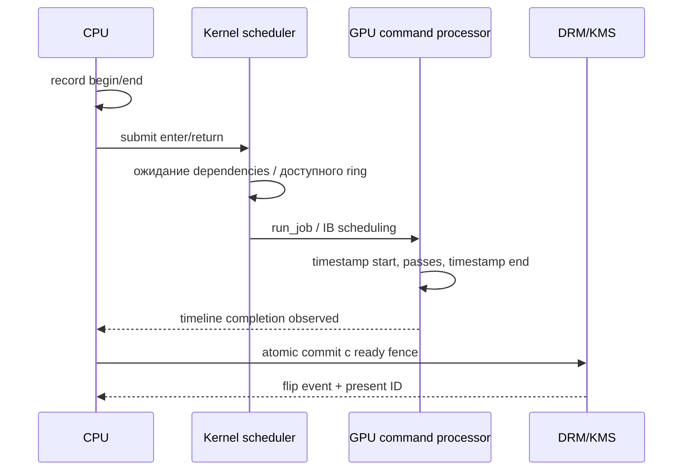

# 03. GPU queues, deadlines и fences

## Реально подтверждённый стек

Для архивного Deck `bench.json` сообщает `AMD Custom GPU 0932 (RADV VANGOGH)`, Mesa `d246f60ddf53089faa1d554865f7a38a737ed388`. Это подтверждение имени устройства/драйвера **в том bench**, не полный manifest установленного сегодня SteamOS.

Исследованный RADV:

- `radv_compute_queue_enabled` допускает compute при наличии reported rings и отсутствии конкретного workaround/debug disable: [src/amd/vulkan/radv_physical_device.c:104](https://github.com/chaotic-cx/mesa-mirror/blob/d246f60ddf53089faa1d554865f7a38a737ed388/src/amd/vulkan/radv_physical_device.c#L104). В `ac_gpu_info` regalloc-hang gate относится к GFX6/Bonaire/Kabini, не VANGOGH: [src/amd/common/ac_gpu_info.c:1004](https://github.com/chaotic-cx/mesa-mirror/blob/d246f60ddf53089faa1d554865f7a38a737ed388/src/amd/common/ac_gpu_info.c#L1004).
- graphics family — одна queue; compute family — количество `info.ip[AMD_IP_COMPUTE].num_queues`: [src/amd/vulkan/radv_physical_device.c:2678](https://github.com/chaotic-cx/mesa-mirror/blob/d246f60ddf53089faa1d554865f7a38a737ed388/src/amd/vulkan/radv_physical_device.c#L2678). Не подставлять число ACE или физических queue slots вместо Vulkan queueCount.
- Vulkan queue index передаётся в winsys submission: [src/amd/vulkan/radv_queue.c:1867](https://github.com/chaotic-cx/mesa-mirror/blob/d246f60ddf53089faa1d554865f7a38a737ed388/src/amd/vulkan/radv_queue.c#L1867); глобальный priority выбирает driver context: [src/amd/vulkan/radv_queue.c:1888](https://github.com/chaotic-cx/mesa-mirror/blob/d246f60ddf53089faa1d554865f7a38a737ed388/src/amd/vulkan/radv_queue.c#L1888).
- priority→AMDGPU context и обработка EACCES: [src/amd/vulkan/winsys/amdgpu/radv_amdgpu_cs.c:1598](https://github.com/chaotic-cx/mesa-mirror/blob/d246f60ddf53089faa1d554865f7a38a737ed388/src/amd/vulkan/winsys/amdgpu/radv_amdgpu_cs.c#L1598).
- timelineSemaphore зависит от kernel timeline syncobj: [src/amd/vulkan/radv_physical_device.c:947](https://github.com/chaotic-cx/mesa-mirror/blob/d246f60ddf53089faa1d554865f7a38a737ed388/src/amd/vulkan/radv_physical_device.c#L947). Gamescope уже требует и использует timeline, поэтому добавление ещё одного абстрактного timeline само по себе ничего не ускоряет.

Linux reference: GFX10.3.1 имеет MEC/compute ring инфраструктуру: [drivers/gpu/drm/amd/amdgpu/gfx_v10_0.c:4775](https://github.com/torvalds/linux/blob/038d61fd642278bab63ee8ef722c50d10ab01e8f/drivers/gpu/drm/amd/amdgpu/gfx_v10_0.c#L4775). Это поддерживает Async Compute как механизм, но восемь CU, кеши и LPDDR5 общие у игры и Kedavra. Физический параллелизм не гарантирует ускорение.

MES: [drivers/gpu/drm/amd/amdgpu/amdgpu_discovery.c:2459](https://github.com/torvalds/linux/blob/038d61fd642278bab63ee8ef722c50d10ab01e8f/drivers/gpu/drm/amd/amdgpu/amdgpu_discovery.c#L2459) подключает MES для GFX11/12, не GFX10.3.1; [drivers/gpu/drm/amd/amdgpu/amdgpu_discovery.c:2787](https://github.com/torvalds/linux/blob/038d61fd642278bab63ee8ef722c50d10ab01e8f/drivers/gpu/drm/amd/amdgpu/amdgpu_discovery.c#L2787) связывает GFX10.3.1 с VANGOGH. **BLOCKED** проект, который требует включить MES на этом пути. Не переносить документацию новых RDNA GPU на Deck.

Приоритет выше NORMAL разрешён CAP_SYS_NICE или DRM master в reference kernel: [drivers/gpu/drm/amd/amdgpu/amdgpu_ctx.c:100](https://github.com/torvalds/linux/blob/038d61fd642278bab63ee8ef722c50d10ab01e8f/drivers/gpu/drm/amd/amdgpu/amdgpu_ctx.c#L100). Gamescope запрашивает REALTIME только при собственной проверке CAP_SYS_NICE, и может откатиться на обычный priority. `pQueuePriorities=1.0` — относительный приоритет queues устройства, не гарантия против другого процесса.

## Что измерять отдельно



| Интервал | Как измерить | Чего он не доказывает |
|---|---|---|
| CPU record | monotonic timestamps вокруг record | GPU execution |
| CPU submit cost | enter/return QueueSubmit, включая возможные CPU stalls | время hardware-start |
| submission→GPU start | calibrated GPU timestamp и CPU submit; kernel markers как промежуточные точки | чистое ожидание scheduler, пока не исключены dependencies |
| dependency wait | IDs acquire/analysis/release points и момент их completion; trace dependency events | любой unexplained gap нельзя автоматически назвать fence wait |
| GPU region elapsed | timestamps вокруг copy/analysis-part/warp/composite | чистое ALU busy: возможны preemption/cache/параллельная работа |
| kernel run_job→finished | drm/amdgpu scheduling/fence events | run_job не первая wave; finished не scanout |
| result ready→flip | сопоставленные calibrated completion и KMS timestamp | время реакции пикселя/всего кадра на панели |
| input→photon | камера/фотодиод и physical input trigger | отсутствующий метод не заменяется status FPS |

Использовать `VK_EXT_calibrated_timestamps` / KHR equivalent только после enumeration; сохранять maxDeviation и clock domain. При отсутствии — GPU elapsed и CPU timestamps публиковать отдельно, submit-to-start = unavailable. `CLOCK_MONOTONIC_RAW`, `CLOCK_MONOTONIC`, GPU clock и KMS clock нельзя просто вычитать. Проверить DRM timestamp monotonic capability и trace_clock, калибровать mapping.

Kernel tracepoint `amdgpu_sched_run_job` находится в [drivers/gpu/drm/amd/amdgpu/amdgpu_job.c:404](https://github.com/torvalds/linux/blob/038d61fd642278bab63ee8ef722c50d10ab01e8f/drivers/gpu/drm/amd/amdgpu/amdgpu_job.c#L404). Он отмечает kernel scheduling, не shader start. `scheduled/finished` fence timestamps в [drivers/gpu/drm/amd/amdgpu/amdgpu_ctx.c:171](https://github.com/torvalds/linux/blob/038d61fd642278bab63ee8ef722c50d10ab01e8f/drivers/gpu/drm/amd/amdgpu/amdgpu_ctx.c#L171) аналогично шире полезного shader execution.

## B1. Deadline-Aware Submission

**SUPPORTED интерфейсы, HYPOTHESIS выигрыш.** Существующий fixed split уже ограничивает порцию анализа, но не учитывает измеренную длину и ближайший deadline. Новый источник раньше cap может втянуть остаток анализа внутрь composite.

Предлагаемый admission rule:
`slack = next_commit_cutoff - now - P99(final_path_cost) - guard`.
В final_path_cost входят CPU submit, queue delay, warp/post/composite и commit overhead соответствующего маршрута. Оценки разделены по mode, source size, transfer, game load и policy epoch.

Порцию analysis отправлять только если её консервативная стоимость помещается до защищённой финальной работы. Если нет — перенести необязательную часть, выбрать готовую пару/реальный кадр, отметить deadline miss. Ограничивать backlog: устаревший analysis можно отбросить **до отправки**, но нельзя разрушить temporal seed, пока он нужен следующей паре. Менять алгоритм поиска не требуется.

Файлы: `kfg.cpp::OnPaint/SubmitAnalysis/RecordGenerate`, `kfg_sched.h::on_me/decide`; backend/vblank cutoff interface. Данные: `DeadlineBudget`, per-stage percentile windows, immutable `AnalysisJob{epoch,pair_id,pass_begin,end,seq}`. Владение входами удерживается до конца submission.

В первом prototype оставить одну queue. Это сохраняет существующую синхронизацию и позволяет доказать, что изменилось ожидание, а не шейдер. Fallback — нынешний split=7 и production scheduler. Governor получает реальные misses, но не меняет мощность во время A/B. Риски: избыточный guard старит контент, слишком мелкие части увеличивают dispatch/submit overhead. Реализация: instrumentation → readiness bridge → shadow admission → controlled admission. Stop: ухудшение real FPS/content age или отсутствие воспроизводимого снижения late path; спецификация E4.

## B2. Separate Compute Queue

**SUPPORTED в RADV, число доступных queues на текущем OLED — gate; выигрыш HYPOTHESIS.**

Это **вторая queue для анализа относительно уже compute-only compositor**, а не первый переход из graphics в compute. Запросить queueCount≥2 и две queue index одной VkDeviceQueueCreateInfo, **с одним global priority**. Создавать две обычные create infos одной family с разными global priorities запрещено: комбинация family/flags должна быть уникальна, а при повторении family global priorities должны совпадать (VUID 02802 и 06654). При отсутствии двух queues оставить одну. См. [VkDeviceCreateInfo](https://docs.vulkan.org/refpages/latest/refpages/source/VkDeviceCreateInfo.html) и [зафиксированный source спецификации](https://github.com/KhronosGroup/Vulkan-Docs/blob/a8b088a3fae12c8575407ea90c7c09bd653db923/chapters/devsandqueues.adoc#L2436).

Предпочесть ту же compute family: меньше queue-family ownership transfers. Внутренние images могут быть EXCLUSIVE той же family с semaphore memory dependencies; для разных families нужны paired release/acquire либо осознанный CONCURRENT sharing с измерением влияния на DCC. Foreign ownership для display остаётся отдельным переходом.

```text
Q_final: capture source / post / copy --signal sourceReady--> [работа вывода]
Q_analysis: wait sourceReady -> analysis chunks -> signal pairReady
Q_final: use только completed pair либо GPU wait при доказанном slack -> warp -> present
```

**Запрет на цикл:** analysis не должен ждать будущий Q_final, уже ожидающий этот analysis. Не вставлять queue-wait на неготовую пару, если нужен repeat текущего ready кадра. Иначе отдельная queue только скрывает блокировку.

`CVulkanDevice::submitInternal` использует общий возрастающий scratch timeline с предположением single queue; upload ring, descriptor seq и pending CMD тоже общие. Нельзя просто вызвать submit на новом VkQueue: higher completed point другой queue ошибочно разрешит reuse ресурсов незавершённой lower submission. Нужны **per-queue timeline, per-queue command pool/retirement и учёт каждого consumer**: [src/rendervulkan.cpp:1323](https://github.com/ValveSoftware/gamescope/blob/aa289ea5977d8b21b92b0f246f0e8f0c225d180f/src/rendervulkan.cpp#L1323).

Изменения: `rendervulkan.hpp/.cpp::BInit/commandBuffer/submitInternal/completedSeqNo/descriptorSet/garbageCollect`; `kfg.cpp::SubmitAnalysis` и immutable job refs. Тест E5 сравнивает serial, same-priority second compute и отдельно B3 с analysis на compute family и final на general family, при одинаковых dispatches. RGP/SQTT capture допустим только при подтверждённой поддержке и с измерением overhead отдельно.

Риски: contention восьми CU, bandwidth/VGPR/LDS, starvation analysis, больше state/preambles, driver regressions. Fallback — drain безопасных jobs, сменить epoch, одна queue. Governor замораживает trials при route/queue-policy changes. Stop: overlap отсутствует либо game FPS/pacing/power ухудшаются; не принимать меньшую warp latency ценой систематического голодания игры.

## B3. Workload Prioritization

**SUPPORTED:** Vulkan global priority и AMDGPU context priority. **REJECTED:** обещание жёсткого deadline, мгновенного preemption или постоянного realtime для всего анализа.

Сейчас analysis наследует priority compositor. Конкретный допустимый кандидат — normal/low analysis на compute family и high/realtime final на general (graphics+compute) family. Обе поддерживают compute dispatch, но требуются release/acquire между families и переделка resource tracking. Две queues одной family в одном VkDevice обязаны иметь один global priority. Альтернатива с двумя VkDevice потребует external sharing и дублирования управления; для первого проекта REJECTED из-за сложности без доказанного выигрыша. Ни kernel patch, ни ручное программирование ACE не нужны. Сначала логировать **фактически созданный** priority и fallback; наличие CAP_SYS_NICE не доказательство успешного REALTIME.

Изменения: тот же device creation B2, `QueuePolicy{requested,granted,family,index}`; cost budget в B1. CPU thread `nice/SCHED_FIFO` отдельно от GPU priority и не заменяет его. Приоритеты требуют создания queues/contexts; горячая смена «на каждый vblank» не предложена.

Время preemption зависит от hardware/firmware и выполняемой работы; public Vulkan не даёт Deck deadline reservation и верхнюю границу вытеснения shader. Scheduler software priorities и hardware high pipe приоритеты различны: [drivers/gpu/drm/amd/amdgpu/amdgpu_ctx.c:67](https://github.com/torvalds/linux/blob/038d61fd642278bab63ee8ef722c50d10ab01e8f/drivers/gpu/drm/amd/amdgpu/amdgpu_ctx.c#L67) и [drivers/gpu/drm/amd/amdgpu/amdgpu_ctx.c:116](https://github.com/torvalds/linux/blob/038d61fd642278bab63ee8ef722c50d10ab01e8f/drivers/gpu/drm/amd/amdgpu/amdgpu_ctx.c#L116).

Владение и fences — как B2, fallback при denied permissions нормальный priority. Риски: starve game/analysis, feedback на cap. E5 проверяет tails и real frames, total APU energy; stop при выигрыше лишь за счёт падения real FPS либо долгих starvation streaks.

## B4. Fence-Driven Pipeline

**CONFIRMED проблема bridge:** `on_me(latch+2,true,false)` ставится до submit. **SUPPORTED решение:** на одной queue сохранить returned sequence конца analysis; `completedSeqNo()` уже есть. Для нескольких очередей использовать отдельные timelines.

```text
latch(id) -> pending INT64_MAX
submit last analysis pass -> job{epoch,id,analysisTimeline,value}
OnPaint:
  completion = query counter без блокировки
  для завершённых jobs текущего epoch:
      on_me(id, current_decision_vblank, success, cut_unknown=false)
  decide()
```

`current_decision_vblank` — первый paint, который **наблюдал** completion. Это консервативная first-usable метка, не точный timestamp окончания; точный GPU timestamp хранить отдельно. Не вызывать scheduler из GPU/query/worker thread: completion события передаются compositor thread. При reset поздний callback старого epoch игнорировать. При ошибке submit/device-lost не сообщать success.

Не ждать всей очереди ради query telemetry. Timestamp availability не связывает result с pair, а `AnalysisTimingDrain` агрегирует части без identity. Тест `test_completion_bridge.c` уже содержит контрпример фиксированного +2 на production scheduler: [kedavra/sched/test_completion_bridge.c:1](https://github.com/wavessevaw/GSF_Kedavra/blob/5f22938b55f9853f764e927c847d9c1a8d9a8c04/kedavra/sched/test_completion_bridge.c#L1). Это программная иллюстрация контракта, не GPU benchmark; здесь новые модельные результаты не выдаются за hardware.

Вторая часть B4 — заменить CPU wait перед KMS реальным ready fence ([02](02-DIRECTSCAN.md)). Это отдельный этап после GPU pass reduction. Нельзя снять wait, оставив сигнальный `IN_FENCE_FD`.

Изменения: `kfg.cpp::State_t/SubmitAnalysis/OnPaint/ResetHistory/AnalysisTimingDrain`, `kfg.hpp`, `DRMBackend.cpp`, `Timeline.cpp/.h`; данные `AnalysisCompletion`, `PresentToken`, `SyncFileLease`. Отдельный GPU→CPU cut readback не нужен для раннего completion prototype: shader cut остаётся текущим. Если scheduler понадобится cut, читать асинхронный компактный stats buffer, не full-frame readback и не блокирующий map.

Fallback — production bridge только как явно выбранный baseline; при runtime ошибке нового маршрута перестать использовать pending pairs и показывать ready real/repeat с последующим безопасным reset. Governor получает unknown readiness вместо ложного успеха. Риски: рост измеренной задержки после устранения оптимистичного прогноза, conservative extra vblank, неверный epoch. E4/E6 проверяет отсутствие use-before-completion, полноту ID correlation и content age. Stop для неблокирующего KMS этапа — новые misses/FD leaks или нулевой CPU/pacing выигрыш.

## Сводка поддержки

| Вариант | Железо/driver | Что остаётся проверить на Deck | Benefit / риск |
|---|---|---|---|
| B1 | Userspace policy, новые hardware функции не нужны | достоверность cost/timing и cutoff | Не измерено; stale content при чрезмерном guard |
| B2 | GFX10.3 compute rings и RADV families SUPPORTED | actual queueCount/priorities, реальный overlap | Не измерено; contention/сложность lifetime |
| B3 | RADV + AMDGPU context priorities SUPPORTED | granted priority и latency tails | Не измерено; starvation |
| B4 | timeline уже используется, source behavior CONFIRMED | completion/epoch adapter, sync_file export | Не измерено; консервативный additional latency |
| MES deadline runtime | отсутствует VANGOGH discovery route | Нет пользовательского переключателя, подтверждающего такой проект | BLOCKED; не предлагать kernel/firmware experiment |

Минимальный порядок — B4 instrumentation/readiness → B1 one-queue admission → A fence handoff → B2/B3. Это позволяет отделить устранение очереди ожидания от чистого shader execution и цены новых submissions.

### Как различать CPU/GPU/DRM waits в принятом результате

Stage timestamp отмечает исполнение только после достижения этой команды GPU. Даже TOP_OF_PIPE timestamp не является временем помещения submission в аппаратную очередь. GPU elapsed, dependency-ready timestamp, kernel scheduled и CPU observed completion сохраняются раздельно; если причины gap неразличимы, публикуется combined delay/unknown. Никакой новый control loop не должен трактовать этот combined delay как чистую shader execution.
