# 04. Память, zero-copy и bandwidth

## Реальная карта данных

```mermaid
flowchart LR
    Game[Game dma-buf] -->|импорт без обязательного копирования| Layer[Gamescope layer 0]
    Layer -->|shader copy один раз на source| Color[6 history colour images]
    Layer -->|если post включён| Post[post ping-pong / SMAA]
    Post -->|RecordCopy| Color
    Color -->|reduce x4| Luma[luma L1..L4]
    Luma -->|ME L4 L3 L2| Flow[bidirectional RGBA16F flow]
    Flow --> Stats[global / cut stats]
    Luma --> Select[select + repair x2]
    Flow --> Select
    Stats --> Select
    Select --> Pair[6 cached pairSelect]
    Color --> Warp[один warp на GEN]
    Pair --> Warp
    Warp --> Out[2 internal output images]
    Out -->|sample и full-frame BLIT| Comp[Gamescope scanout image]
    Color -->|REAL sample и BLIT| Comp
    Comp -->|DRM FB metadata / без pixel copy| DCN[DCN scanout read]
```

Общая память APU не устраняет чтения, записи, cache flush и decompression. DMA-buf import не означает, что весь путь стал zero-copy: `RecordCopy` — полноценный compute dispatch, а BLIT пишет другой image.

Владение, lifetime и source readiness — [01](01-CURRENT-PIPELINE.md). Ресурсы создаются один раз на размер/transfer, а не на каждый кадр: [kedavra/gamescope/src/kfg/kfg.cpp:446](https://github.com/wavessevaw/GSF_Kedavra/blob/5f22938b55f9853f764e927c847d9c1a8d9a8c04/kedavra/gamescope/src/kfg/kfg.cpp#L446). Полное выключение освобождает историю. `KFG_RING=4` в standalone plan header не равен `k_uRing=6` в integration; capacity нельзя выводить только из тестового host.

## Инвентарь при 1280×800

Расчёт логических texel bytes, **не измеренный VRAM/LPDDR traffic**. Нет alignment, metadata/DCC, allocations Gamescope/game, post/HUD и driver overhead.

| Ресурс | Количество и размер | Логические bytes |
|---|---|---:|
| colour history SDR | 6 × 1280×800 × 4 | 24 576 000 |
| generated outputs SDR | 2 × 1280×800 × 4 | 8 192 000 |
| luma | 6 × (640×400 + 320×200 + 160×100 + 80×50) × 1 | 2 040 000 |
| flow L2..L4 | 6 × (320×200 + 160×100 + 80×50) × 8 | 4 032 000 |
| pairSelect | 6 × 320×200 × 8 | 3 072 000 |
| select scratch | 2 × 320×200 × 8 | 1 024 000 |
| stats | 6 × 4×1 × 8 | 192 |
| Всего SDR |  | 42 936 192 (≈40,95 MiB) |
| Всего HDR FP16 colour/output | Только colour/output удваиваются | 75 704 192 (≈72,20 MiB) |

Formats/allocations: [kedavra/engine/kfg_plan.h:197](https://github.com/wavessevaw/GSF_Kedavra/blob/5f22938b55f9853f764e927c847d9c1a8d9a8c04/kedavra/engine/kfg_plan.h#L197), [kedavra/gamescope/src/kfg/kfg.cpp:456](https://github.com/wavessevaw/GSF_Kedavra/blob/5f22938b55f9853f764e927c847d9c1a8d9a8c04/kedavra/gamescope/src/kfg/kfg.cpp#L456). Два full-resolution post images добавляют 8 192 000 bytes SDR или 16 384 000 FP16; SMAA edges/weights и LUTs — отдельно. Это не повод уменьшать history без доказательства scheduler lifetime.

Устраняемый SDR full-frame read+write при 1280×800: `2×1280×800×4 = 8 192 000` логических bytes на pass. При 90 eligible outputs/s — 737 280 000 bytes/s. Если direct только GEN: ×2 45→90 — 368 640 000; ×3 30→90 — 491 520 000 bytes/s. Это **арифметическая работа image stage**, не обещание освобождённого DRAM bandwidth: caches, DCC и scanout tiling меняют фактический traffic. Для current FP16 промежуточного чтения + 32-bit composite записи считать 8+4 bytes/pixel, а не автоматически 8+8.

## C1. Убрать post → ring copy

**CONFIRMED лишняя отдельная стадия в коде / HYPOTHESIS измеримый эффект.**

[kedavra/gamescope/src/kfg/kfg.cpp:822](https://github.com/wavessevaw/GSF_Kedavra/blob/5f22938b55f9853f764e927c847d9c1a8d9a8c04/kedavra/gamescope/src/kfg/kfg.cpp#L822) строит post plan, затем при pInto вызывает `RecordCopy(s.pPost[nRing],pInto)`. [kedavra/engine/kfg_post.h:205](https://github.com/wavessevaw/GSF_Kedavra/blob/5f22938b55f9853f764e927c847d9c1a8d9a8c04/kedavra/engine/kfg_post.h#L205) описывает последнюю целевую image каждого filter chain.

| Пункт проекта | Решение |
|---|---|
| Текущая архитектура | source → post scratch chain → copy → history |
| Ограничение | Последний результат материализуется дважды |
| Предлагается | Только destination **последнего** post pass заменить на `KFG_ROLE_COLOR(curSlot)` / explicit output ref |
| Почему экономнее | Та же фильтрация, исчезает отдельный full-frame copy dispatch/read/write |
| Файлы | `kfg.cpp::RecordPost/RecordGenerate/ResolveRef`; при необходимости `kfg_post.h::kfg_plan_post` получает optional final ref |
| Данные | `PostDestination{role,slot}`, отдельное подтверждение no-alias последнего dst с его inputs |
| API | Текущие storage writes/sample, новых Mesa/kernel interfaces нет |
| Владение | History принадлежит Kedavra; mark valid только после записи plan и успешной submission |
| Sync | Same queue image barriers; последующий reduce читает тот же history, readiness через B4 |
| Fallback | Empty/unsupported post, alias или allocation failure — старый plan + copy либо обычный source copy |
| Governor | Не меняет controls; новый stage timing/epoch и cost accounting |
| Риски | Нельзя глобально переназначить роль POST[nRing]: scratch slot используется многократно; фильтры нельзя сделать in-place |
| Этапы | Redirect final dst → pixel parity SDR/PQ/scRGB paths → аппаратный full pipeline A/B/A |
| Проверка | E7, все комбинации last pass: grade/sharpen/FXAA/SMAA blend/finish |
| Stop | Нет побитового/обоснованного эквивалентного результата; разница cost ниже шума; новые barriers съедают выигрыш |

При активной генерации фильтры уже стоят перед кольцом. Сохраняем это поведение и то, что анализ видит filtered pixels. Не менять одновременно порядок post и destination. В post-only режиме без generation нет history target; текущий путь остаётся. Устранённая copy выполнялась на source FPS, не display FPS: при 30 source/s SDR это 245 760 000 логических bytes/s, не аппаратная оценка.

## C2. «Не копировать source вообще»

**REJECTED как универсальная замена.** История может удерживать до шести source frames; game swapchain часто существенно меньше. Retain imported image + game release point до конца всех analysis/warp/scanout consumers может заблокировать игру в acquire. DMA-buf zero-copy здесь меняет backpressure, а не только память.

Условный limited experiment возможен лишь для готового immutable buffer с достаточным lifetime, без post/format conversion, с лимитом retained game images и немедленным возвратом к copy до истощения swapchain. Изменения: `Frame_t` хранит borrowed Rc+release lease, `RecordGenerate` выбирает capture mode; освобождение по всем consumers, а не по истечению двух vblank. Это ниже C1/A: измерить game acquire stalls, source FPS и memory traffic. Stop при backpressure или потере 10-bit SDR→8-bit current behaviour parity.

## C3. Copy + reduce L1 fusion

**HYPOTHESIS, позже.** Один dispatch мог бы читать source, писать history colour и luma L1, устраняя reread history. Но нынешний descriptor ABI имеет один storage target: [kedavra/shaders/kfg_common.glsl:17](https://github.com/wavessevaw/GSF_Kedavra/blob/5f22938b55f9853f764e927c847d9c1a8d9a8c04/kedavra/shaders/kfg_common.glsl#L17). Нужен второй storage binding/специальная pipeline layout в Gamescope и standalone host, tiled 2×2 loads, сохранение exact bilinear resampling/rounding и HDR luma conversion. Переделка не локальна.

Нельзя выдать texelFetch исходного 10-bit SDR за эквивалент анализа после 8-bit history quantization. Fused вариант обязан воспроизвести именно current colour conversion. С post фильтрами luma должна соответствовать последнему filtered colour; fusion source copy не применима. Файлы: `kfg_copy.comp/kfg_reduce.comp/kfg_common.glsl`, `kfg_plan.h`, `kfg.cpp`, Gamescope descriptors и `kfg_vk.c`. Данные/ownership — оба targets одного epoch/history slot; compute write barriers на оба. Fallback — отдельные passes; E7+E8 проверяют bandwidth и качество. Stop если extra VGPR/LDS или layout overhead уничтожают выгоду.

## Modifiers, layouts, reusable memory

Использовать existing pooled allocations; не realloc каждый кадр. Reallocation на resize/HDR/analysis-size требует drain/epoch и удержания старых refs до retirement. Не делать alias memory между luma/flow/history без доказанного непересекающегося lifetime: несколько delayed pairs живы одновременно.

В Vulkan imported/external image ownership и visibility задаются barriers, не FD. `GENERAL` — layout, не гарантия coherence или отсутствия DCC transitions. Gamescope делает external FOREIGN release на CMD flush: [src/rendervulkan.cpp:1966](https://github.com/ValveSoftware/gamescope/blob/aa289ea5977d8b21b92b0f246f0e8f0c225d180f/src/rendervulkan.cpp#L1966). Любая B2 вторая family должна пересмотреть этот tracker; один CPU `image->queueFamily` не описывает одновременно несколько consumers.

DCC может сокращать traffic, но storage stores/import/scanout combinations имеют ограничения: [src/amd/vulkan/radv_image.c:244](https://github.com/chaotic-cx/mesa-mirror/blob/d246f60ddf53089faa1d554865f7a38a737ed388/src/amd/vulkan/radv_image.c#L244) и [src/amd/vulkan/radv_image.c:318](https://github.com/chaotic-cx/mesa-mirror/blob/d246f60ddf53089faa1d554865f7a38a737ed388/src/amd/vulkan/radv_image.c#L318). Сравнить поддержанные tiled uncompressed и display-compatible DCC варианты на **одинаковом content/usage**, включая возможный decompress/retile. Не форсировать unsupported modifier и не предлагать linear как заранее лучший. В A1 логировать выбранный modifier на каждом pool generation.

## SDMA / async copies

**SUPPORTED аппаратный механизм, HYPOTHESIS польза; не первый проект.** На исследованном RADV dedicated transfer queue gated по SDMA и `RADV_PERFTEST_TRANSFER_QUEUE`: [src/amd/vulkan/radv_physical_device.c:79](https://github.com/chaotic-cx/mesa-mirror/blob/d246f60ddf53089faa1d554865f7a38a737ed388/src/amd/vulkan/radv_physical_device.c#L79). COMPUTE family с TRANSFER_BIT не доказывает работу на SDMA: там copy может исполняться shader/CP путём.

`RecordCopy` поддерживает форматную конверсию, raw sampling и history encoding; не всякая операция заменяется `vkCmdCopyImage`. Для exact compatible copy можно отдельно проверить transfer usage/modifier support и hardware engine trace. Передачи family ownership, fence и power overhead включать в net result. Даже SDMA на APU расходует общую bandwidth. E8: compute copy vs legal transfer copy vs removed copy; запрет driver/kernel установки ради этого. Fallback — current compute copy; stop при отсутствии net energy/latency benefit.

## Что уже оптимизировано и что не предлагается

Cached pair selection, reuse pyramid предыдущего source, bounded analysis resolution, один warp на GEN и allocation reuse уже существуют. Уменьшение search radius, resolution, bit depth или отключение Mura ради меньшего traffic изменяет качество и не является допустимым доказательством hardware-native выигрыша. Полная замена алгоритма не нужна для C1/A/B4.
