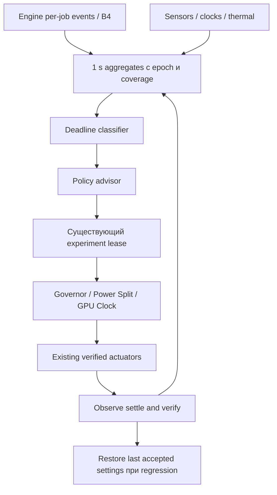

# 05. Deadline-Aware APU Governor

## Проверенная текущая архитектура

GFG Governor находится в **другом репозитории**, GFG Extreme `6b22036b503006f63956b8919cdaa9bf91f1a3c3`. Здесь его код не изменяется.

- `service.py::tick` собирает engine status, policy, pilot, sensors, Power Split, GPU Clock и Governor; передаёт real/pace/over_budget/ring_miss/temperature/power и epoch: [py_modules/gfg_plugin/service.py:223](https://github.com/wavessevaw/GFG-Extreme/blob/6b22036b503006f63956b8919cdaa9bf91f1a3c3/py_modules/gfg_plugin/service.py#L223).
- `Governor.tick` работает с секундными samples и окнами, проверяет thermal, ownership, external changes и конкурирующий experiment: [py_modules/gfg_plugin/governor.py:369](https://github.com/wavessevaw/GFG-Extreme/blob/6b22036b503006f63956b8919cdaa9bf91f1a3c3/py_modules/gfg_plugin/governor.py#L369).
- Реальные константы и thresholds смотреть в коде, не в старом вводном docstring. Например текущие thermal policy constants отличаются от части текстового описания: [py_modules/gfg_plugin/governor.py:46](https://github.com/wavessevaw/GFG-Extreme/blob/6b22036b503006f63956b8919cdaa9bf91f1a3c3/py_modules/gfg_plugin/governor.py#L46).
- `Autopilot.decide` выбирает objective/reason с battery/heat hysteresis, а не сам пишет clocks: [py_modules/gfg_plugin/autopilot.py:48](https://github.com/wavessevaw/GFG-Extreme/blob/6b22036b503006f63956b8919cdaa9bf91f1a3c3/py_modules/gfg_plugin/autopilot.py#L48).
- `PowerSplit.step` пробует CPU cap при удерживаемом real FPS и проверяет результат: [py_modules/gfg_plugin/power_split.py:143](https://github.com/wavessevaw/GFG-Extreme/blob/6b22036b503006f63956b8919cdaa9bf91f1a3c3/py_modules/gfg_plugin/power_split.py#L143).
- `GpuClockControl.tick` требует steady/confirmed point и исключает параллельные trials: [py_modules/gfg_plugin/gpu_clock_control.py:85](https://github.com/wavessevaw/GFG-Extreme/blob/6b22036b503006f63956b8919cdaa9bf91f1a3c3/py_modules/gfg_plugin/gpu_clock_control.py#L85).
- GPU clock actuator использует SteamOS Manager и restore receipt, а не OverDrive: [py_modules/gfg_plugin/gpu_clock.py:1](https://github.com/wavessevaw/GFG-Extreme/blob/6b22036b503006f63956b8919cdaa9bf91f1a3c3/py_modules/gfg_plugin/gpu_clock.py#L1).
- TDP actuator имеет ownership, journal, verify slow/fast и rollback; manager path либо проверенная пара hwmon caps: [py_modules/gfg_plugin/governor_power.py:367](https://github.com/wavessevaw/GFG-Extreme/blob/6b22036b503006f63956b8919cdaa9bf91f1a3c3/py_modules/gfg_plugin/governor_power.py#L367). `SteamOSManagerTdp` использует steamosctl либо session D-Bus, проверяет доступность/range: [py_modules/gfg_plugin/steamos_tdp.py:1](https://github.com/wavessevaw/GFG-Extreme/blob/6b22036b503006f63956b8919cdaa9bf91f1a3c3/py_modules/gfg_plugin/steamos_tdp.py#L1).
- Policy coordinator завершает набор convars revision и принимает его только после свежего echo: [py_modules/gfg_plugin/policy.py:132](https://github.com/wavessevaw/GFG-Extreme/blob/6b22036b503006f63956b8919cdaa9bf91f1a3c3/py_modules/gfg_plugin/policy.py#L132).

Имеющаяся sample схема содержит GPU elapsed aggregates, но не подтверждённый per-pair deadline miss, queue delay и dependency wait. `gpu_us_avg` включает разную работу, а `me_ready` в engine объявлен прогнозом +2: [01](01-CURRENT-PIPELINE.md). Поэтому повышение мощности по одному `over_budget` не отделяет compute от ожидания.

## Телеметрия и границы

| Сигнал | Источник / units | Достоверность и ограничение |
|---|---|---|
| GPU busy | amdgpu gpu_busy_percent | Глобальный GPU, не только игра/Kedavra; не causal classifier |
| GPU clock | hwmon freq1_input Hz; pp_dpm_sclk active entry | Label и support проверять; DPM table не всегда мгновенная частота |
| CPU clock/load | cpufreq actual freq, /proc/stat по cores | Среднее CPU скрывает busiest core; delivered freq может отличаться от requested |
| APU power | hwmon power1_average/input µW с label | На APU включает CPU; отсутствие sensor = null, не 0 W |
| Session energy | интеграл валидных power samples, J/Wh | Не путать TDP cap с measured power; пропуски samples и charger effects учитывать |
| Analysis/warp/composite elapsed | Vulkan timestamps с job identity | Не чистое busy время при contention/preemption |
| Submit/queue/dependency delay | CPU markers, calibrated timestamps, kernel events | Раздельная coverage; без mapping = unavailable |
| Deadline misses | intended target/cutoff vs actual pair/result readiness | KMS miss, source late и algorithm fallback — отдельные counters |
| Thermal state | sensor labels/temperature + throttling evidence | Threshold policy не менять; temperature не единственная причина clock drop |
| Real/gen/output/content | commit IDs, pair/phase, present ID, optical check | Flip FPS нельзя подставлять вместо real FPS |

Документированный sensor ABI: [Linux v6.16 power/thermal](https://www.kernel.org/doc/html/v6.16/gpu/amdgpu/thermal.html). Текущий Kedavra repo уже имеет read-only sampler с units и unavailable handling: [decky/py_modules/gsf_amdgpu.py:47](https://github.com/wavessevaw/GSF_Kedavra/blob/5f22938b55f9853f764e927c847d9c1a8d9a8c04/decky/py_modules/gsf_amdgpu.py#L47). Наличие интерфейса в документации не гарантирует его наличие на данном APU/SteamOS.

## Проект контроллера

**SUPPORTED telemetry interfaces / HYPOTHESIS экономия.**



Engine не пишет sysfs и не вызывает D-Bus из render/KMS thread. Он публикует bounded telemetry queue; worker агрегирует статистику. Deadline controller — advisor существующего service, а не пятый независимый writer.

Новые структуры:

```text
DeadlineSample:
  schema, engine_session_id, policy_revision, route_epoch, sample_seq
  start_ns, end_ns, clock_domain, coverage, source_frames, output_frames
  analysis_us{p50,p95,p99}, warp_us{...}, composite_us{...}
  queue_delay_us{...}|null, dependency_wait_us{...}|null
  ready_margin_us{p05,p50}, analysis_deadline_miss_count
  final_deadline_miss_count, kms_unobserved_slots, repeat_reasons
  gpu_busy, gpu_mhz, cpu_top_core_pct, cpu_mhz, apu_w, temp_c
  unsupported_mask, timing_max_deviation_ns

DeadlineAdvice:
  class, evidence_coverage, action, previous_verified_point
  trial_id, actuator, settle_until, verify_until, rollback_reason
```

Per-frame telemetry допускает workload diagnosis; actuator остаётся медленным секундным/оконным контуром. У SMU/clocks нет обещанного мгновенного перехода за несколько миллисекунд; per-vblank TDP modulation **REJECTED**.

### Классификация

1. **Execution limited:** elapsed analysis/warp растёт, confirmed dependencies готовы, submit→start мал, slack падает. Проверить, сокращает ли возврат к предыдущей принятой частоте duration при том же workload. Это основание отменить неудачное снижение clock/TDP, не поднимать ceiling.
2. **Dependency limited:** incoming source или analysis point опаздывает, очередь финального кадра ждёт fence. Исправлять B1/B4/routing; повышение TDP не считать лечением без causal A/B.
3. **Queue contended:** dependencies готовы, но submit→start длинный на фоне игры/другого GPU процесса. Сначала ограничить analysis backlog и work volume. Рост частоты теоретически может помочь игре/всей очереди, но нужен отдельный trial, не правило «busy → watts».
4. **CPU/source limited:** real frame cap не удерживается, busiest core ограничен, GPU простаивает. Существующий Power Split может быть неподходящим; отменить его trial, сохранить CPU headroom.
5. **Display/route limited:** result ready рано, но KMS/CPU present задержан. Частота GPU не основная гипотеза; проверить atomic path/overlays/commit.
6. **Thermal constrained / Unknown:** existing thermal guard имеет приоритет; при недостаточных данных advisor не пишет controls.

Высокий global busy не доказывает полезный Kedavra compute. Низкий busy на 100-ms окне может скрывать короткий критичный warp. Только привязка к job/clock/load и повторяемый trial отделяет причины.

### Objective и правила

Минимизировать measured `∫P_APU(t)dt` при сохранении выбранного real cap, разрешённых image settings, deadline-miss/content-age/latency ограничений. В режиме диагностического A/B Autopilot, фильтры и лимиты фиксируются, чтобы не спутать изменение качества с оптимизацией.

1. При свежем confirmed policy и стабильном workload разрешить **один** trial: TDP *или* CPU split *или* GPU clock.
2. Нижний расход принимается только если real FPS, deadline tails, content-age и image criteria не ухудшились сверх заранее заданных допусков. Не принимать старый `pace` как единственный gate.
3. При miss spike отменить именно последнюю пробу, вернуть last verified point и дождаться проверки readback. Не назначать все ошибки «недостаточно watts».
4. После source/refresh/route/HDR/queue-policy changes увеличить epoch и сбросить cost window; не смешивать SDR и HDR измерения.
5. При stale status, отсутствующей timing coverage, suspend/menu/другом владельце controls остановить trials; действовать через штатный restore path.
6. Никаких новых minimum/maximum hardware limits, изменений thermal constants, firmware/SMU/voltage. Пользовательский ceiling и действующая policy остаются верхней границей. Снижение полезной плавности не цель.

### Конкретные изменения

| Пункт проекта | Инженерное решение |
|---|---|
| Текущая архитектура | GFG service сводит секундные rates и global sensors |
| Ограничение | Нет actual-ready deadline и измерений причин ожидания |
| Новая архитектура | Engine event stream + advisor + единый existing lease |
| Почему экономнее | Не держит лишние clocks при waits; отменяет вредные power trials по реальной причине |
| Файлы | Kedavra `kfg.cpp::WriteStatus/SubmitAnalysis/OnPaint`; GFG `service.py::tick`, новый `deadline_advisor.py`, `governor.py::healthy/tick`, eligibility в `power_split.py/gpu_clock_control.py` |
| Новые данные | DeadlineSample/Advice, session/route epoch, missing-data mask, accepted-point evidence |
| Interfaces | Existing status/convar revision; Vulkan timestamps/timelines; read-only hwmon/cpufreq; existing SteamOS actuators |
| Владение buffers | Advisor не получает GPU buffers/DRM fd; telemetry copies bounded scalar metadata |
| Sync | Worker publishes immutable sample; render/KMS never waits on controller |
| Fallback | Нет schema/capability/свежести — current Governor без deadline advice, controls restore через current ownership |
| Совместимость | Autopilot задаёт objective, pilot cap; Governor TDP, Split CPU, Clock GPU; один lease, общий epoch |
| Риски | Двойное управление, overfitting по одной сцене, false causal classification, stale status; watchdog/lease mandatory |
| Этапы | read-only advisor → shadow verdicts → bounded reversible clock trial → TDP/Split integration |
| Hardware proof | E9, минимум несколько нагрузок, 30-min A/B/A и повторные power sessions |
| Stop | Нет подтверждаемой классификации; энергия не снижается; растут misses/latency; восстановление не подтверждается |

Предлагаемая интеграция не переносит controller в этот repo без отдельного задания. Для handoff разработчик получает оба pinned source roots и места стыковки; rollout и controller tests должны быть отдельным PR в GFG Extreme.
