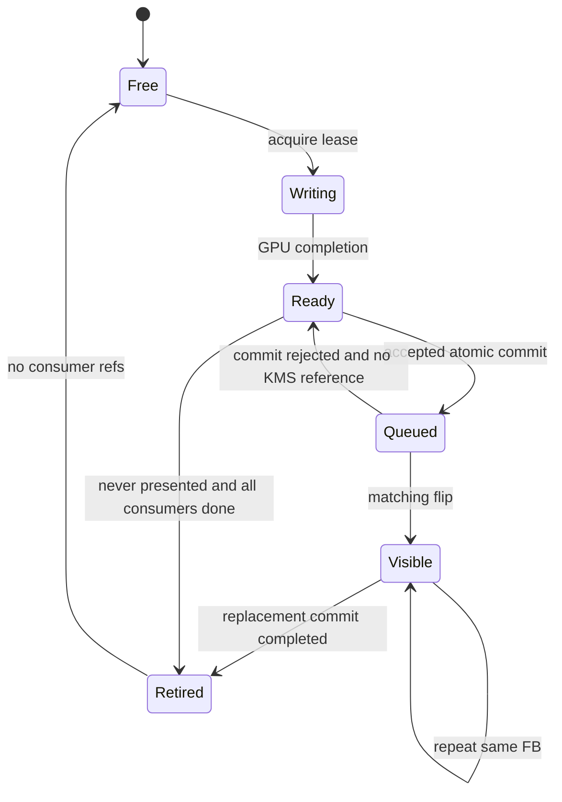

# 07. Проект реализации и handoff

Этот документ — проект будущих изолированных изменений. Текущая ветка содержит документацию, read-only probe и повторный анализ архивов. Патчи runtime, kernel, Mesa, installation и releases не входят в неё.

## Общие контракты

Предлагаемые типы внутри integration, не готовый ABI:

```cpp
struct EpochKey {
    uint64_t engineSession;   // новый при каждом запуске процесса
    uint64_t policyRevision;
    uint64_t historyEpoch;    // focus/resize/HDR/refresh/reset
    uint64_t routeEpoch;      // output capabilities / queue policy
};

struct AnalysisJob {
    EpochKey epoch;
    uint64_t pairA, pairB;
    uint32_t firstPass, endPass;
    QueueTimelinePoint completion;
    // Сильные references на входы, outputs и temporal seed.
};

struct PreparedFrame {
    EpochKey epoch;
    uint64_t paintId;
    kfg_decision decision;
    Rc<CVulkanTexture> texture;
    Rc<IBackendFb> backendFb;
    QueueTimelinePoint ready;
    SyncFileLease kmsReadyFence; // optional, собственник FD определён
    OutputLease lease;
    LayerMetadata original;
    bool recorded;
};

struct PresentToken {
    EpochKey epoch;
    uint64_t presentId, paintId, sourceA, sourceB;
    uint32_t crtcId, phaseNum, phaseDen;
    OutputLease visibleLease;
};
```

`QueueTimelinePoint` содержит owner queue ID, semaphore и value, а не один общий глобальный sequence для нескольких очередей. `SyncFileLease` — move-only FD, закрывается на всех success/error/fallback ветках; borrowed FD не закрывать, imported FD — по Vulkan rules. У `OutputLease` есть writer completion, все GPU consumers и последний KMS replacement token. `CapabilityKey` включает DRM device/CRTC/mode, plane topology, format/modifier, rotation, colorspace/transfer, Mura/UI/effects/capture state.

### Slot state machine



Не переводить Writing→Ready после одного `vkQueueSubmit`. Не переводить Visible→Free по собственному первоначальному out-fence. Device-lost/suspend/hotplug ведут через teardown, epoch invalidation и гарантированное отпускание references; обычный timeout не доказывает, что GPU/KMS перестал читать память.

### Неприкосновенные свойства

- Game и engine buffers не перезаписываются, пока есть GPU/scanout consumer.
- Original layer metadata не теряется при замене texture. Преобразованный display-encoded output имеет явно обновлённую metadata, а не унаследованную scRGB.
- Один paint — не более одной generation recording; fallback использует тот же подготовленный результат.
- Scheduler и state mutates только compositor thread; KMS/worker передаёт immutable events.
- Никакого blocking disk/controller I/O из deadline path; bounded telemetry с explicit lost-event counter.
- Прошлый runtime остаётся доступным без rebuild. Все новые пути выключены по умолчанию до аппаратной приёмки.

## Очерёдность отдельных будущих PR

| Этап | Содержание и файлы | Gate перехода |
|---|---|---|
| 0. Evidence contract | `kfg.cpp` per-job markers, `DRMBackend.cpp::Commit/page_flip_handler` token correlation; status schema | Loss/identity accounting; timestamps clock mapping; реальная 1.4.1 A/A baseline |
| 1. C1 final post target | `RecordPost`, optional final ref в `kfg_post.h` | Те же images, минус один dispatch; unchanged quality; E7 |
| 2. B4 completion bridge | `State_t/SubmitAnalysis/OnPaint/ResetHistory` | Ни одной пары до actual completion; epoch stress и E4 |
| 3. B1 admission | `SubmitAnalysis`, bounded backlog/cost windows, vblank cutoff | E4: tails/content age/game FPS не хуже, отсутствие starvation |
| 4. A2 prepare separation | `kfg.hpp`, hooks, `paint_all`, `vulkan_composite`, `DRMBackend::Present` | На forced-composite путь полностью эквивалентен baseline; no duplicate work |
| 5. A1 allocation + DirectScan | `CreateImage/EnsureImages`, output lease, DRM FB/capability cache | SDR TEST_ONLY, actual scanout, overlays/Mura/fallback lifetime, E1–E3 |
| 6. Fence-driven KMS | `submitInternal`, Timeline bridge, per-layer IN_FENCE_FD | E6: no CPU wait dependency violation, no FD leak, measured benefit |
| 7. GFG advisor | Engine telemetry + отдельный GFG service/advisor PR | Shadow verdicts, then reversible trial; E9 |
| 8. Optional B2/B3/R1/R2/R3 | queue lifetime refactor или shader variants, отдельными changesets | Только после profiling, E5/E8; не смешивать причины выигрыша |

Этап 0 логически первый, хотя DirectScan — главный объект исследования. Рейтинг архитектур [09](09-FEASIBILITY-MATRIX.md) не означает, что безопасно начинать kernel/display changes без измерений. C1 может проверяться параллельно по смыслу, но каждый аппаратный A/B меняет только одну переменную.

## Interface deltas по source roots

Все roots pinned в [10](10-SOURCES.md).

| Root / файл | Функции/структуры | Контракт изменения |
|---|---|---|
| Kedavra `kfg.cpp` | State_t, Frame_t | Epoch, per-job completion, no raw slot reuse while consumers live |
| Kedavra `kfg.cpp` | OnPaint | Process observed completions before scheduler decision |
| Kedavra `kfg.cpp` | RecordGenerate, RecordComposite | Produce PreparedFrame once; separate generation from full composite |
| Kedavra `kfg.cpp` | SubmitAnalysis | Return/store timeline, bounded pass chunk and immutable pair inputs |
| Kedavra `kfg.cpp` | OnPresented/OnPageFlip | PresentToken correlation; abandon decision-only FIFO as sole identity |
| Kedavra `kfg.cpp` | RecordPost | Only final destination override, no in-place neighbourhood filters |
| Kedavra `kfg.hpp`, `hooks.patch` | preparation/public integration | Keep physical output-only gating and source cap policy |
| `kfg_sched.h` | on_me / slot readiness | Completion-observed input; existing decision algorithm initially unchanged |
| Gamescope `rendervulkan.hpp/.cpp` | texture createFlags/BInit | Compatible sampled/storage/flippable allocations; return unsupported, not assert |
| Gamescope renderer | output pool/submit/wait/GC | OutputLease; later per-queue lifetimes, memory barriers, ready export |
| Gamescope `DRMBackend.cpp` | Present/drm_prepare_liftoff | Prepared layer route; preserve existing full-composite conditions; per-layer FD |
| Gamescope DRM | Commit/page_flip_handler/DRMPresentCtx | Match IDs/CRTC, retire old slot, rollback safely |
| GFG `service.py/policy.py` | tick / revision handshake | Fresh schema + route epoch → existing experiment lease |
| GFG power modules | Governor/Split/Clock eligibility | Advisor classification, preserve verified ownership/restore |
| Mesa / kernel | существующие API | Изменений не требуется для первых семи этапов |

Для B2/B3 нужен отдельный design review: descriptor/update upload ring и shared scratch timeline сейчас однокьюшные. Разные global priorities одной family в одном device запрещены Vulkan; допустимая cross-family схема требует additional release/acquire. Не «добавлять queue» без этого refactor.

## Переключение и rollback

Три fallback уровня:

1. **Per-frame capability fail:** composition уже подготовленного texture, сохранить overlays/HDR/capture. Без повторного motion analysis/warp.
2. **Feature fault:** отключить новый путь, drain retained resources, перейти на production capture/generation/composite с новым epoch.
3. **Session/GPU/DRM failure:** штатный Gamescope session recovery на отдельном стенде; запуск проверенного binary из сохранённого prefix. Не пытаться продолжать использовать device-lost resources.

Экспериментальные binaries хранить в отдельном prefix/dev session на выделенном тестовом устройстве. В рамках этого исследования **не выполнять** существующий `kedavra/deck/install.sh`: он bind-mounts binary над пользовательским Gamescope и выходит за запрет менять текущую установку. Отдельная будущая hardware сессия должна иметь проверенный возврат к исходной сессии и исходным control receipts. Kernel/Mesa/firmware пользовательского Deck остаются штатными.

## Передача первому разработчику

Первый PR: только instrumentation и actual completion; входные артефакты — manifest, trace schema, A/A noise floor, tests of epoch/lifetime. Второй небольшой PR: C1. DirectScan — после prepare split с forced-composite equivalence и validated allocation inventory. Не объединять все идеи в один performance claim.

Для каждого PR в описании: конкретный удалённый pass/wait, before/after submission diagram, неизменённые условия image/power, ссылки на raw A/B/A, negative cases и стоп-критерии. Если hardware benefit отсутствует — сохранить исследование и закрыть feature, не переносить его в default runtime.
