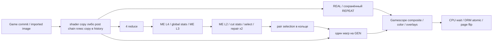

# 12. Повторный аудит официального v1.4.1: сокращение работы и ошибок выбора

Дата: 25 октября 2026. База: официальный [v1.4.1](https://github.com/wavessevaw/GSF_Kedavra/releases/tag/v1.4.1), commit `5f22938b55f9853f764e927c847d9c1a8d9a8c04`. Последний stable повторно проверен через GitHub Releases. Это исследование исходников и изолированные предложения; рабочие shaders, main, установленный Gamescope, kernel, Mesa и лимиты мощности не изменены.

## Вывод

Есть два новых конкретных места для улучшения: повторный SAD одинаковых predictors в ME и некорректное отбрасывание кандидата warp при недоступном двухстороннем сравнении цвета. Для обоих подготовлены небольшие patches, CPU-проверки и успешная компиляция/валидация SPIR-V непосредственно на Deck. Снижение GPU-времени, энергопотребления и улучшение реального изображения **пока не измерены**. Прошедшая компиляция не равна выполнению GPU-программы.

Третье предложение — подбор Wave32/Wave64 отдельно для каждого KFG pipeline. Возможность подтверждена на предоставленном OLED; полезность требует измерений. Повышение приоритета всего Gamescope не выбрано: оно может задерживать игру и тем самым ухудшать ввод.

Условия пользователя обязательны: не увеличивать input latency и энергопотребление. Фиксированный TDP cap не доказывает выполнение второго условия. Изменение не принимается только на основании улучшения среднего GPU timestamp.

## Фактическая архитектура релиза

Полная карта владения, DRM и синхронизации — [01-CURRENT-PIPELINE.md](01-CURRENT-PIPELINE.md). Ниже повторно проверенные узлы, существенные для новых предложений. Ссылки фиксируют SHA, а не плавающую main.

| Участок | Исполняемое поведение | Значение для оптимизации |
|---|---|---|
| `WantsComposite()` | [kfg.cpp:1066](https://github.com/wavessevaw/GSF_Kedavra/blob/5f22938b55f9853f764e927c847d9c1a8d9a8c04/kedavra/gamescope/src/kfg/kfg.cpp#L1066) требует композиции при генерации | DirectScan требует отдельной подготовки кадра, простого удаления флага недостаточно |
| `OnPaint()` | [kfg.cpp:1071](https://github.com/wavessevaw/GSF_Kedavra/blob/5f22938b55f9853f764e927c847d9c1a8d9a8c04/kedavra/gamescope/src/kfg/kfg.cpp#L1071) считает новые commit, обновляет сетку и scheduler; сбросы по focus/size/transfer | Real FPS нельзя получать из flip FPS; загрузки и смену игры исключать из steady-state |
| Готовность анализа | [kfg.cpp:1237](https://github.com/wavessevaw/GSF_Kedavra/blob/5f22938b55f9853f764e927c847d9c1a8d9a8c04/kedavra/gamescope/src/kfg/kfg.cpp#L1237) сообщает `on_me(...,nVBlank+2,true,false)` до исполнения | Это прогноз, не фактический completion; уменьшение ME может улучшить запас времени без изменения scheduler delay |
| Кольцо | [kfg.cpp:82](https://github.com/wavessevaw/GSF_Kedavra/blob/5f22938b55f9853f764e927c847d9c1a8d9a8c04/kedavra/gamescope/src/kfg/kfg.cpp#L82): integration держит 6 slots; [выделения:448](https://github.com/wavessevaw/GSF_Kedavra/blob/5f22938b55f9853f764e927c847d9c1a8d9a8c04/kedavra/gamescope/src/kfg/kfg.cpp#L448) | Standalone `KFG_RING=4` нельзя переносить в описание production; копия сохраняет независимость от game swapchain lifetime |
| Вход в историю | [kfg.cpp:1281](https://github.com/wavessevaw/GSF_Kedavra/blob/5f22938b55f9853f764e927c847d9c1a8d9a8c04/kedavra/gamescope/src/kfg/kfg.cpp#L1281) фильтрует source один раз, затем copy; без post — copy source | Фильтры уже не обязательно исполняются на каждом GEN; повторно продавать такую оптимизацию нельзя |
| Analysis plan | [kfg_plan.h:309](https://github.com/wavessevaw/GSF_Kedavra/blob/5f22938b55f9853f764e927c847d9c1a8d9a8c04/kedavra/engine/kfg_plan.h#L309): 4 reduce, 3 ME, global stats, cut stats, select, 2 repair = 12 dispatch | Pair field создаётся один раз; стандартный GEN не повторяет select/repair |
| GEN | [kfg_plan.h:396](https://github.com/wavessevaw/GSF_Kedavra/blob/5f22938b55f9853f764e927c847d9c1a8d9a8c04/kedavra/engine/kfg_plan.h#L396) использует готовый pair field и один warp; [kfg.cpp:1303](https://github.com/wavessevaw/GSF_Kedavra/blob/5f22938b55f9853f764e927c847d9c1a8d9a8c04/kedavra/gamescope/src/kfg/kfg.cpp#L1303) подставляет output в layer 0 | Экономия анализа относится к паре source, экономия warp — к каждому GEN |
| Очередь | [SubmitAnalysis:1404](https://github.com/wavessevaw/GSF_Kedavra/blob/5f22938b55f9853f764e927c847d9c1a8d9a8c04/kedavra/gamescope/src/kfg/kfg.cpp#L1404): две части в той же queue, после presentation; остаток может попасть в следующий composite | Ускорение ME может уменьшать задержку последующей композиции, но нельзя обещать конкретную экономию vblank |
| GPU timing | [RecordComposite:1355](https://github.com/wavessevaw/GSF_Kedavra/blob/5f22938b55f9853f764e927c847d9c1a8d9a8c04/kedavra/gamescope/src/kfg/kfg.cpp#L1355), [AnalysisTimingDrain:567](https://github.com/wavessevaw/GSF_Kedavra/blob/5f22938b55f9853f764e927c847d9c1a8d9a8c04/kedavra/gamescope/src/kfg/kfg.cpp#L567) | `gpu_us` не включает отдельный analysis и окончательный Gamescope composite; интервалы timestamps не дают автоматически queue waiting time |
| Presentation | [OnPresented:1444 / OnPageFlip:1466](https://github.com/wavessevaw/GSF_Kedavra/blob/5f22938b55f9853f764e927c847d9c1a8d9a8c04/kedavra/gamescope/src/kfg/kfg.cpp#L1444) ведут FIFO trace | Flip подтверждает событие KMS, но не новый контент или input-to-photon |

Standalone host `kfg_vk.c` имеет собственный fence wait после submission. Это не доказательство такого wait после каждого production dispatch. Новые shader proposals не меняют queue, barriers, владение изображениями, форматы или число retained frames.

## Что подтверждено на предоставленном Steam Deck OLED

Пассивный SSH inventory: Galileo, SteamOS 3.9.5, kernel `7.2.7-valve2-2-neptune-72-g31504582a073`; `vulkaninfo` определяет `AMD Custom GPU 0932 (RADV VANGOGH)`, device ID `0x1435`, Mesa `26.2.0-devel (git-5c65d4fc31)`. Это сведения работающего драйвера, а не предположение по RDNA 2. Полный SHA исходников именно этой сборки Mesa пока не установлен.

| Возможность | Результат | Что ещё не доказано |
|---|---|---|
| Graphics/compute family | family 0: 1 queue, graphics+compute+transfer | Доступность этой queue в уже созданном VkDevice Gamescope |
| Compute family | family 1: 4 queues, compute+transfer, timestampValidBits=64 | Полезный параллелизм; четыре очереди не означают четыре независимых вычислительных двигателя |
| Subgroup | default 64, min 32, max 64; subgroupSizeControl и computeFullSubgroups=true | Выигрыш каждого shader и допустимость required size для нужного stage проверяются при создании pipeline |
| Synchronization | timelineSemaphore, synchronization2, calibrated timestamps доступны | Корректность нового host bridge и измерение submission-to-start |
| Memory/display | external_memory_dma_buf и image_drm_format_modifier доступны | Intersection STORAGE_IMAGE + modifier + KMS plane/rotation/color для конкретного формата |
| Приоритеты | global priority/query extensions перечислены | Разрешение конкретного priority, реальная preemption latency и отсутствие ущерба игре |

Текущая установленная сборка сообщает `kedavra-4aa7740-gfg-696a2cf`; это не доказанная побайтовая копия официального ZIP и не ранее подготовленный HardwareRuntime experiment. Поэтому её live counters — наблюдение системы, **не baseline A/B официальных бинарников**. Официальный release сообщает совпадение engine с rc.1, но хеш executable не проверен.

## Предложение 1: переиспользование SAD базового predictor

**CONFIRMED:** [kfg_me.comp:130](https://github.com/wavessevaw/GSF_Kedavra/blob/5f22938b55f9853f764e927c847d9c1a8d9a8c04/kedavra/shaders/kfg_me.comp#L130) вычисляет SAD каждого из шести predictors, даже если `preds[i] == preds[0]`. Пять берутся из coarse field и соседей, последний — global motion. В однородном движении они могут совпадать; частота совпадений в реальной игре ещё не измерена.

Изменение: в не-coarsest ветке `search()` сохранить один `base_sad`, переиспользовать только при точном равенстве displacement, иначе выполнять прежний `sad()`. Для каждого кандидата оставить его исходный origin penalty, порядок и строгий `<`. Просто пропускать повторный predictor неправильно как общий приём: последний global predictor имеет отдельное правило origin.

Новая структура данных: один локальный float, никаких image/buffer allocations, LDS, новых dispatch или истории. Coarsest lattice, temporal seeding, search radius, subpixel refinement и quality heuristics не меняются. Действующие владение и synchronization остаются у host.

Модель числа SAD в predictor loop: 6→1 при полном совпадении, 6→2 при пяти одинаковых и отличающемся global, 6→6 при разных. На L2 одно SAD содержит 9 texture samples. Для 320×200 blocks, двух направлений и пяти исключённых SAD это до 5 760 000 texture-sampling instructions на пару **в указанном частном случае**. Это не количество DRAM transactions/bytes и не процент ускорения всего анализа; остальные стадии остаются.

Проверки: 32 187 детерминированных CPU случаев, включая ties и global origin, сохранили winner/origin/cost. Baseline и proposal скомпилированы `glslangValidator` на Deck, `spirv-val --scalar-block-layout` прошёл. CPU модель не исполняет texture filtering, весь search или ACO ISA и не заменяет readback equality на GPU.

**HYPOTHESIS:** меньше sampling work уменьшит analysis duration и конкуренцию с игрой. Риск: добавленный float/comparisons и divergence могут увеличить VGPR, spills либо ухудшить сценарии с уникальными predictors. SPIR-V стал больше, что само по себе ничего не говорит о скорости native ISA. Измерять ACO properties и GPU duration на одинаковом входе. Остановить внедрение при ухудшении p95/p99 analysis, frame-time игры, энергии или pixel equality. Возврат — baseline pipeline; runtime restart только через plugin после завершения игры.

## Предложение 2: корректный duplicate skip на границе кадра

**CONFIRMED, CPU counterexample:** [kfg_warp.comp:101](https://github.com/wavessevaw/GSF_Kedavra/blob/5f22938b55f9853f764e927c847d9c1a8d9a8c04/kedavra/shaders/kfg_warp.comp#L101) пропускает геометрический дубль own candidate до проверки доступности photometric comparison. Внутри изображения одинаковый вектор даёт одинаковую RGB-ошибку; own bias действительно выигрывает. За границей используется `cand[i].w`, который у одинаковых векторов может различаться.

Контрпример: own `v=(64,0), residual=.19`, сосед с тем же вектором и residual `.01`, третий кандидат `v=(0,0)` с RGB error `.10`. Для `p=(2,102), t=.5`, 1280×800 первый вектор читает A.x=-30 и B.x=34. Release отбрасывает второй кандидат, затем выбирает нулевой вектор (.10 < .19-.02). Полный перебор выбирает вектор 64 (.01 < .10). Это изменение **геометрии**, а не только веса двух одинаковых кандидатов.

Patch вычисляет `photo_valid` до skip; duplicate skip разрешён только когда двухсторонний RGB test доступен. OOB-кандидаты сравнивают каждый свой residual. Сохраняются прежние bias, tie order и edge fade. Новых texture reads для OOB, passes, images, history или CPU readback нет; есть дополнительные bounds/comparison ALU для дубликатов. Ровно прежний путь остаётся при доступном photometric test.

Проверки: явный контрпример и 50 000 randomized случаев сопоставлены с exhaustive reference без duplicate skip; исправленная модель совпала. Baseline/proposal прошли compile и SPIR-V validation. **HYPOTHESIS:** меньше неверных переключений вектора на mixed-motion borders. Нельзя объявлять увеличение PSNR: другой победитель ещё не означает лучший ground truth. Для этого требуется GPU fixture с известной геометрией, mixed residuals, disocclusion и третьим distinct motion. Если quality corpus или энергия ухудшаются, предложение отклоняется либо пересматривается. Подмена исходной метрики на «более физичную» не входит в этот patch.

## Предложение 3: Wave32/Wave64 для конкретных pipelines

**SUPPORTED:** устройство допускает subgroup control 32..64. Использовать [VkPipelineShaderStageRequiredSubgroupSizeCreateInfo](https://docs.vulkan.org/refpages/latest/refpages/source/VkPipelineShaderStageRequiredSubgroupSizeCreateInfo.html) в `pNext` shader stage, после проверки feature и `requiredSubgroupSizeStages`. Не менять env всего Gamescope/игры.

Первый стенд: `kedavra/engine/kfg_vk.c`, `kfg_vk_init()` около строки 250; добавить конфигурацию required subgroup size per shader, включить нужные features в device creation, запросить pipeline executable properties. Production: pipeline key/create path в Gamescope `src/rendervulkan.cpp` с KFG-specific вариантом; диспетчер `RecordPlan()` выбирает его. Нельзя менять общий pipeline cache key без включения subgroup size: иначе A/B может сравнить одну pipeline дважды.

Новые данные: `KfgPipelineVariant {shader, subgroupSize, featureMask, shaderHash}`, capability snapshot, native register/LDS/spill statistics, timings. Размер workgroup пока сохраняется: ME 8×8, stats — свой. Wave32 может помогать ME и вредить stats; выбор независимый. Владение изображениями и barriers прежние; fallback — обычная pipeline при неподдержке, creation error или регрессии. Никаких RT priority, частот и TDP изменений.

Документация [RADV](https://docs.mesa3d.org/drivers/radv.html) описывает ACO и shader execution; это объясняет механизм, но не доказывает ускорение данного кода. Реальные A/B и properties на `git-5c65d4fc31` обязательны. Отказаться от варианта при spills, увеличении энергии/ввода или статистически неотличимом результате после повторных блоков.

## Отдельная очередь, confidence и ранее сделанные предложения

Отдельная compute queue остаётся **HYPOTHESIS**, несмотря на подтверждённые 4 queues. Потребуются timeline, fence/epoch lifetime пары, зависимости source read/write, общий scratch либо отдельный scratch на in-flight pair и ownership transfer при разных queue families. Очереди используют те же 8 CU и память. Увеличение приоритета не создаёт ресурсов; постоянное вытеснение игры противоречит ограничению input latency. Поэтому сначала уменьшаем работу и измеряем queue delay.

Confidence требует отдельного исследования: [kfg_select.comp:184](https://github.com/wavessevaw/GSF_Kedavra/blob/5f22938b55f9853f764e927c847d9c1a8d9a8c04/kedavra/shaders/kfg_select.comp#L184) pair path возвращает `best_cost` до `KFG_EXPERIMENT_RAW_CONFIDENCE`. Стандартный `kfg_per_phase_select=0` использует именно pair path. Включение этого macro само по себе не проверяет confidence штатного runtime. `best_cost` также относится к выбору до subpixel refinement и содержит добавочные terms. Дополнительный recalculation на всех blocks увеличит sampling work; такое решение пока не выбрано.

DirectScan, фактический completion/deadline и post→history уже описаны и предложены ранее в [02](02-DIRECTSCAN.md), [03](03-GPU-SCHEDULING.md), [04](04-MEMORY-ZERO-COPY.md), [11](11-NON-DECK-COMPARISON.md). Они остаются полезными кандидатами, но не выдаются за новые находки повторного аудита. Новый shader cache совместим с ними и должен тестироваться отдельно до комбинации.

Не выбраны: глобальное повышение priority, отключение sharp/blur ради скорости, снижение analysis resolution без quality evidence, замена цвета HDR на RGBA8, глобальный `cswave32`, raw PM4/прямое вмешательство в очереди RADV, установка другого kernel/Mesa ради предположения. Уменьшение LDS shader stats не объявляется выгодой без анализа dispatch: single-workgroup workload не получает дополнительной межгрупповой параллельности автоматически.

## Передача разработчику и приоритеты

| Приоритет | Что и где менять | Потенциальный эффект | Feasibility / risk / evidence |
|---|---|---|---|
| 1 | raw SAD cache в `kfg_me.comp::search` | меньше повторных texture samples на анализ пары; ms/W не измерены | Высокая; риск ACO/VGPR; source + CPU equivalence + compile |
| 2 | conditional duplicate skip в `kfg_warp.comp::main` | исправить выбор у OOB boundary; quality gain не измерен | Высокая; риск visual regression; counterexample + exhaustive reference + compile |
| 3 | KFG-specific subgroup variants в standalone host, затем Gamescope pipeline creation | лучший register/occupancy balance; ms/W не измерены | Средняя; риск performance/compatibility; device capability подтверждена |

Порядок: прочитать [протокол](13-RELEASE-1.4.1-VALIDATION.md), воспроизвести CPU checks, выполнить GPU readbacks и timings в изоляции, только затем готовить переключаемую plugin build. Acceptance требует A/B/A против точного официального baseline, одинаковых настроек и отдельного контроля игры, качества, presentation, energy и input latency. При отсутствии измеримого результата оставить предложение исследовательским.

Артефакты: [CPU proof](evidence/release-audit-1.4.1/candidate-proof.json), [скрипт проверки](evidence/release-audit-1.4.1/prove_candidates.py), [SPIR-V validation](evidence/release-audit-1.4.1/shader-validation.json), [ME patch](evidence/release-audit-1.4.1/proposals/kfg_me.comp.patch), [warp patch](evidence/release-audit-1.4.1/proposals/kfg_warp.comp.patch). Patches не применены к рабочим исходникам.
